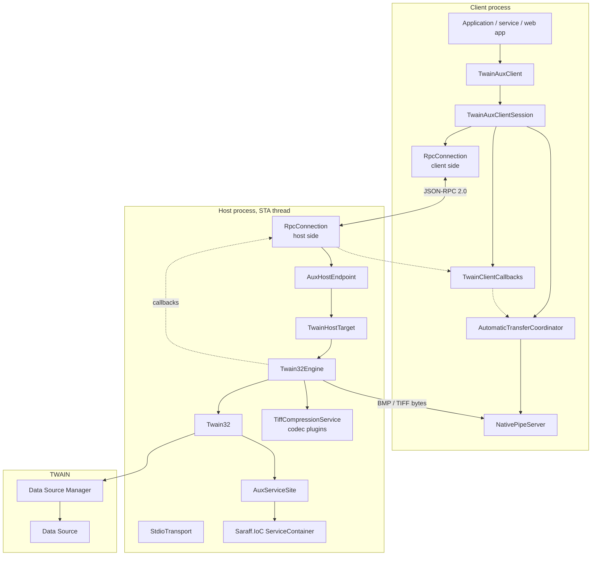
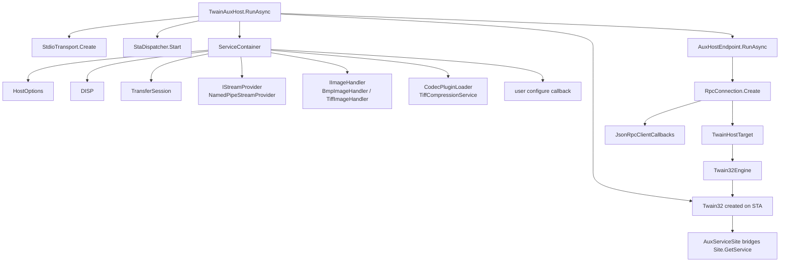
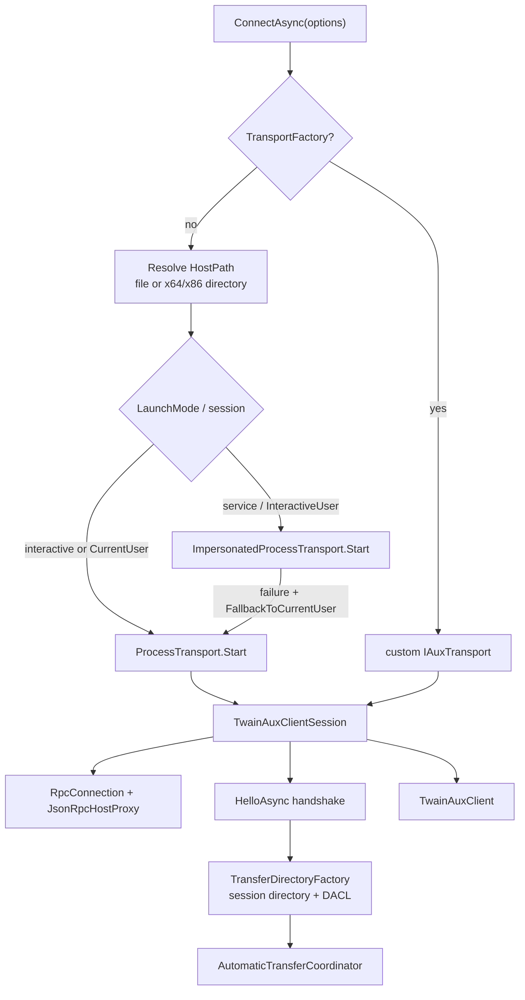
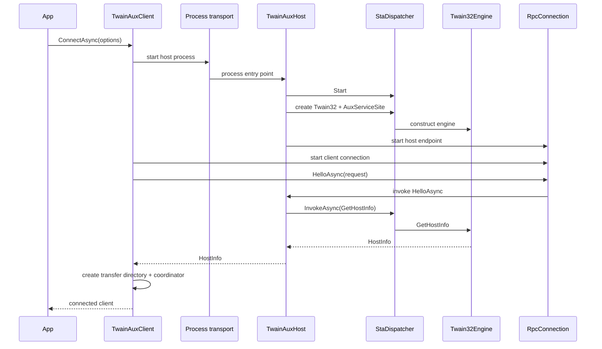
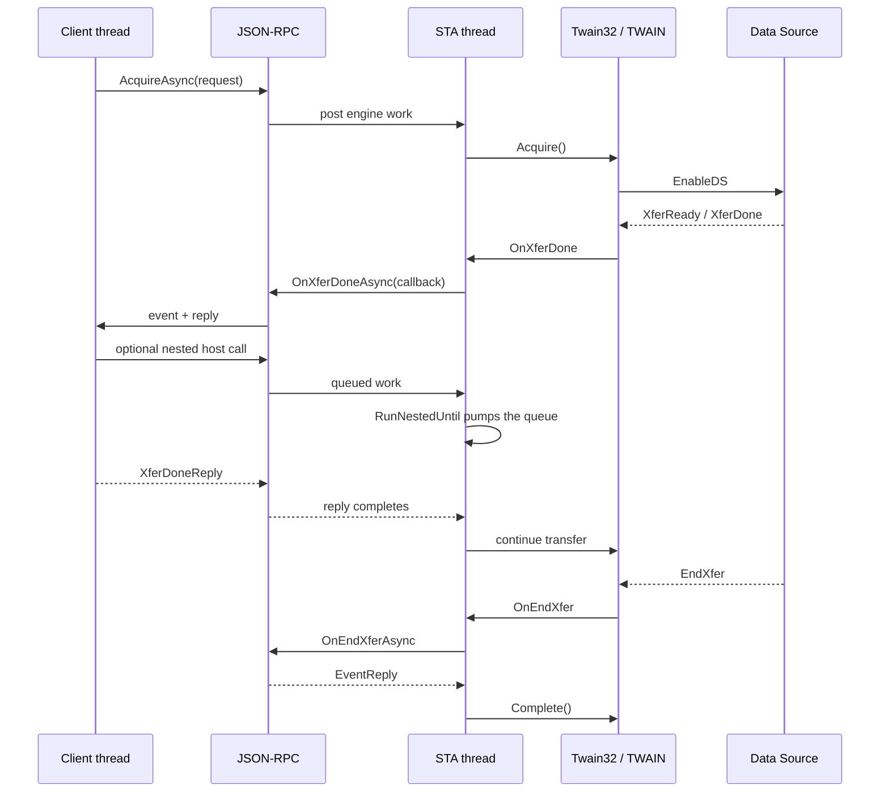
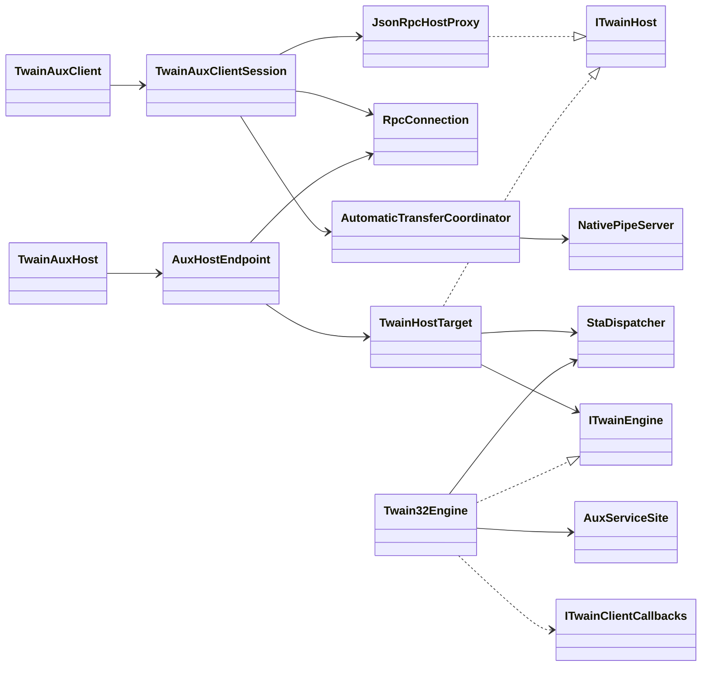

[All products](../) / [Saraff.Twain.Aux](./index.md)
# Architecture

`Saraff.Twain.Aux` splits TWAIN access into two processes:

* the **host** owns the real `Saraff.Twain.Twain32` object and the TWAIN session;
* the **client** owns the application-facing async API and the transfer coordinator.

The boundary is a JSON-RPC 2.0 connection over the host's redirected stdin/stdout. Images can
travel over a separate named pipe, as JSON memory chunks, or as files.

## Process boundaries

The **host is single-session**: one DSM connection, one current data source and one active
acquisition at a time. The client can create many `TwainAuxClient` instances, but with the default
process transports each one starts its own host process.

## Host composition

`TwainAuxHost.RunAsync` builds the host in this order:

`AuxServiceSite` is required because `Saraff.Twain` resolves `IStreamProvider` and `IImageHandler`
through `Component.GetService`. The site forwards those requests to the `Saraff.IoC` container.
Its `Container` property is deliberately `null`, so `Component.Dispose` does not remove `Twain32`
from the container.

## Client composition

`TwainAuxClient.ConnectAsync` selects a transport and builds the client session:

`TwainAuxClientSession.InitializeAsync` starts the JSON-RPC connection, creates the host proxy,
performs the protocol handshake and then creates the transfer directory and coordinator. If the
handshake or initialization fails, the transport and container are disposed.

## Main types

### Client

| Type | Role |
|---|---|
| `TwainAuxClient` | Async client facade; connects to the host and exposes events and `Host` |
| `TwainAuxClientOptions` | Host path, launch mode, timeouts, limits, transfer directory |
| `TwainAuxClientSession` | Owns the RPC connection, host proxy, callbacks and coordinator |
| `TwainClientCallbacks` | Client-side implementations of `ITwainClientCallbacks` and public events |
| `AutomaticTransferCoordinator` | Creates pipes, assembles memory data, reads/deletes files |
| `TransferResult` | Mode, format, bytes, image, file path, page count, compression, error |
| `TwainAuxClientSync` | Obsolete blocking facade over the async client |

### Host

| Type | Role |
|---|---|
| `TwainAuxHost` | Entry point; creates transport, dispatcher, container, `Twain32` and endpoint |
| `HostOptions` | Protocol, DSM path, parent window, limits, transfer directory, codecs |
| `AuxHostEndpoint` | Creates the host-side RPC connection and registers the local target |
| `TwainHostTarget` | `ITwainHost` implementation; marshals every call to `StaDispatcher` |
| `ITwainEngine` | Engine abstraction used by the host target and fake-engine tests |
| `Twain32Engine` | Real engine; owns `Twain32`, events, transfer state and TIFF assembly |
| `FileTransferPolicy` | Validates file-transfer paths, applies ACLs and cleans up files |
| `CodecPluginLoader` | Scans plugin assemblies and registers `ITiffCompressionCodec` instances |

### Transport and RPC

| Type | Role |
|---|---|
| `IAuxTransport` | Byte duplex transport: `Input`, `Output`, wait/kill/dispose |
| `ProcessTransport` | Redirected stdin/stdout of a normal child process |
| `ImpersonatedProcessTransport` | `CreateProcessAsUser` host launch for services |
| `StdioTransport` | Host-side stdin/stdout transport; reserves stdout for the protocol |
| `InMemoryTransport` | In-memory duplex pair for tests |
| `RpcConnection` | `LengthHeaderMessageHandler` + `SystemTextJsonFormatter` + `JsonRpc` |
| `TwainRemoteException` | Client-side wrapper for a remote invocation failure |

### Transfers and composition

| Type | Role |
|---|---|
| `TransferSession` | Host-side current stream, pending pipe sink and last bytes/file |
| `NativePipeServer` | Client-side named pipe server with SID ACL and BMP/TIFF reader |
| `NativePipeClientWriter` | Host-side pipe writer used by MemoryTiff |
| `NamedPipeStreamProvider` | `IStreamProvider` used by Saraff.Twain native transfer |
| `BmpImageHandler`, `TiffImageHandler` | Convert a packed DIB pointer into BMP/TIFF |
| `DibImageConverter` | Packed DIB to BMP conversion |
| `MemoryTransferAssembler` | Assembles memory chunks into BMP or concatenated data |
| `MemoryTiffAccumulator` | Assembles one uncompressed MemXfer image into a TIFF |
| `MemoryMultipageTiffAccumulator` | Accumulates pages into one multi-page TIFF |
| `TiffCompressionService` | Resolves and applies built-in or plugin TIFF codecs |
| `StaDispatcher` | Single STA thread with WinForms message pump and nested pumping |
| `AuxServiceSite` | Bridges `System.ComponentModel.ISite` to the IoC container |

### Contracts

| Type | Role |
|---|---|
| `ITwainHost` | Host RPC methods (session, capability, transfer, palette, state) |
| `ITwainClientCallbacks` | Client callback methods (transfer events, errors, device events, logs) |
| `AuxProtocol` | Protocol major/minor version (2.3) |
| `AuxFeatures` | Feature flags reported by the host |
| `HostInfo` | Host protocol, versions, bitness, SID, DSM path, features, codecs |
| `SourceInfo`, `SourceIdentityDto` | Data source metadata |
| `AcquireRequest`, `TransferOptions` | Acquisition and transfer parameters |
| `CapabilityRequest`, `CapabilityValue` | Typed capability access over the wire |
| DTOs in `Events.cs` | State, acquire-completed, error, device-event and log payloads |
| `JsonDefaults` | STJ web defaults, null omission and string enums |

## Startup and handshake

The handshake compares the protocol **major** version. A mismatch throws
`InvalidOperationException` with both versions in the message.

## Request path and callback re-entrancy

A normal RPC call is marshaled to the STA thread. Transfer callbacks are different: the engine is
already on the STA thread and must wait for the client's reply while the client may call back into
the host.

`StaDispatcher.RunNestedUntil` calls `Application.DoEvents()` and drains queued work while the
callback task is outstanding. This is what allows a client to invoke `GetImageInfoAsync` or another
host method from inside `XferDone` without deadlocking the single TWAIN thread.

## Type map

## Design constraints

* **One TWAIN thread.** Saraff.Twain 1.0.34 requires every TWAIN operation to run on the thread
  that performed the first operation. The host never calls `Twain32` from the JSON-RPC thread.
* **One active acquisition.** The engine keeps per-acquisition state (`_currentMode`, chunk index,
  TIFF accumulators); overlapping acquisitions are not supported.
* **stdout is protocol-only.** The host redirects `Console.Out` to stderr so user code cannot
  corrupt the JSON-RPC framing.
* **Client and host must agree on protocol major version.** Both sides use the same contracts
  package and `AuxProtocol.Version`.
* **Bitness is a deployment decision.** The host is built for `x86` and `x64`; the client selects
  the matching directory or uses an explicit executable path.
* **No network listener.** Communication is local child-process stdio plus local named pipes.
* **Client events are not UI-thread marshaled.** `RpcConnection` uses no synchronization context,
  so `TwainAuxClient` events are raised on the RPC callback thread. Marshal to the UI thread and
  do not block the callback for long.
* **Disposal is explicit.** `TwainAuxClient.DisposeAsync` asks the host to shut down, disposes the
  transport and removes the session transfer directory it created.

## Next

* [Protocol](./Protocol.md) — framing, handshake, RPC methods and callbacks
* [Transfers](./Transfers.md) — native, memory, TIFF and file transfer flows
* [Service Hosting](./ServiceHosting.md) — launch modes, impersonation and ACLs
