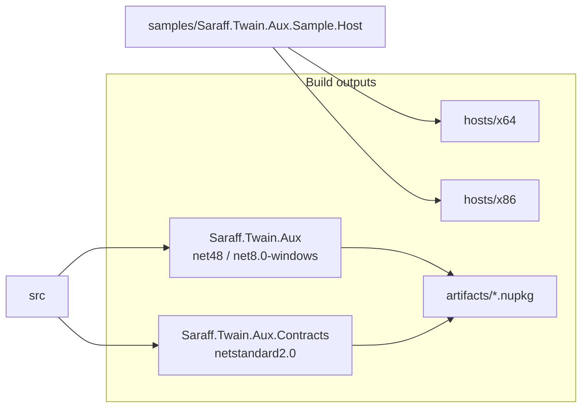

[All products](../) / [Saraff.Twain.Aux](./index.md)
# Build and Test

## Projects

| Project | Target | Purpose |
|---|---|---|
| `src/Saraff.Twain.Aux.Contracts` | `netstandard2.0` | Wire DTOs, `ITwainHost`, `ITwainClientCallbacks`, protocol version, STJ defaults |
| `src/Saraff.Twain.Aux` | `net48`, `net8.0-windows` | Client, host endpoint, transports, DI composition, STA dispatcher, transfers |
| `tests/Saraff.Twain.Aux.Tests` | `net10.0-windows` locally | Protocol, DI, transfer, conversion and file-policy tests |
| `tests/Saraff.Twain.Aux.X86TwainModeProbe` | `x86` console | Real DSM probe for TWAIN 1.x/2.x modes |
| `tests/Saraff.Twain.Aux.TestCodecPlugin` | plugin test assembly | Diagnostic TIFF codec for plugin tests |
| `samples/Saraff.Twain.Aux.Sample.Host` | `net48` | Minimal host executable |
| `samples/Saraff.Twain.Aux.Sample.Client` | console | List/scan sample with all transfer modes |
| `samples/Saraff.Twain.Aux.Sample.ServiceProbe` | `net48` | Service/impersonation handshake probe |
| `samples/Saraff.Twain.Aux.Sample.CodecPlugin` | plugin | JPEG TIFF codec built on BitMiracle.LibTiff.NET |

The test project targets `net10.0-windows` because the local development machine uses the .NET 10
SDK. The shipped library still builds for `net48` and `net8.0-windows`.



## Build and test

```powershell
dotnet build .\Saraff.Twain.Aux.sln
dotnet test .\tests\Saraff.Twain.Aux.Tests\Saraff.Twain.Aux.Tests.csproj
dotnet pack .\src\Saraff.Twain.Aux\Saraff.Twain.Aux.csproj -c Release
```

For a release build with packages in `artifacts`:

```powershell
dotnet build .\Saraff.Twain.Aux.sln -c Release
dotnet test .\tests\Saraff.Twain.Aux.Tests\Saraff.Twain.Aux.Tests.csproj -c Release --no-build
dotnet pack .\src\Saraff.Twain.Aux.Contracts\Saraff.Twain.Aux.Contracts.csproj -c Release --no-build -o artifacts
dotnet pack .\src\Saraff.Twain.Aux\Saraff.Twain.Aux.csproj -c Release --no-build -o artifacts
```

## Build both host bitnesses

```powershell
powershell -ExecutionPolicy Bypass -File .\build-hosts.ps1
```

The script runs:

```powershell
dotnet build .\samples\Saraff.Twain.Aux.Sample.Host\Saraff.Twain.Aux.Sample.Host.csproj `
    -c Release -p:PlatformTarget=x86 -o artifacts/hosts/x86
dotnet build .\samples\Saraff.Twain.Aux.Sample.Host\Saraff.Twain.Aux.Sample.Host.csproj `
    -c Release -p:PlatformTarget=x64 -o artifacts/hosts/x64
```

The resulting layout is:

```text
artifacts
├── hosts
│   ├── x64
│   │   └── Saraff.Twain.Aux.Sample.Host.exe
│   └── x86
│       └── Saraff.Twain.Aux.Sample.Host.exe
└── *.nupkg
```

Point `TwainAuxClientOptions.HostPath` at `artifacts/hosts` or at one executable.

## Sample client

```powershell
# Handshake and host info
dotnet run --project .\samples\Saraff.Twain.Aux.Sample.Client -- .\artifacts\hosts

# List data sources
dotnet run --project .\samples\Saraff.Twain.Aux.Sample.Client -- --list .\artifacts\hosts

# Scan all modes
.\scripts\test-scanner.ps1 -Mode native -Format bmp -Output C:\temp\scan-native.bmp
.\scripts\test-scanner.ps1 -Mode native -Format tiff -Output C:\temp\scan-native.tif
.\scripts\test-scanner.ps1 -Mode memory -Output C:\temp\scan-memory.bmp
.\scripts\test-scanner.ps1 -Mode memtiff -Compression LZW -Output C:\temp\scan-lzw.tif
.\scripts\test-scanner.ps1 -Mode multipagetiff -Compression LZW -Output C:\temp\scan-multipage-lzw.tif
.\scripts\test-scanner.ps1 -Mode memfile -Output C:\temp\scan-memfile.bin
.\scripts\test-scanner.ps1 -Mode file -Output C:\temp\scan-file.bin
```

Manual scanner checklist:

* Native BMP/TIFF is not truncated, opens in an image viewer and matches `XferDone` dimensions.
* Memory chunks assemble correctly, including 8 bpp palette when the source exposes one.
* MemFile produces a readable file and the client deletes it on session dispose.
* File transfer writes inside the client session directory; the client reads and deletes it when
  `DeleteTransferredFiles` is `true`.
* Multi-page results report `PageCount > 1` and each result is usable.
* `ShowUI = true` displays the DSM UI on the interactive desktop.
* `CancelAcquireAsync` cancels a non-modal/automatic transfer at the next event.
* Named-pipe ACL works across users.
* `SetPalette`/`ResetPalette` works for palette sources.
* `ExtImageInfo` values are present when the source supports them.

## x86 TWAIN mode probe

```powershell
.\scripts\test-x86-twain-modes.ps1
```

Expected output:

```text
===== x86 IsTwain2Enable=False =====
  IsTwain2Supported=False Sources=1
  SetDefaultSource: expected TWAIN 1.x limitation: DG DAT MSG out of expected sequence.
  Acquire returned; ImageCount=1
===== x86 IsTwain2Enable=True =====
  IsTwain2Supported=True Sources=1
  SetDefaultSource: OK
  Acquire returned; ImageCount=1
X86 TWAIN MODES: PASS
```

The probe uses the real DSM, `ShowUI = false` and requires an installed TWAIN source. The virtual
`Saraff Screen DS` works.

## Service probe

Run from an elevated PowerShell:

```powershell
powershell -ExecutionPolicy Bypass -File .\scripts\test-service-impersonation.ps1
```

See [Service Hosting](./ServiceHosting.md#service-checklist) for the expected SID and checklist.

## Validation matrix

| Area | Coverage |
|---|---|
| JSON-RPC transport, handshake, protocol version | Fake-engine/protocol tests |
| DI composition and `AuxServiceSite` | Tests |
| Native BMP transfer | Virtual Saraff Screen DS, 1920x1080, 24 bpp, 6,220,854 bytes |
| Native TIFF conversion | Handler tests; native TIFF scan is a manual checklist item |
| Memory transfer | Assembled BMP, same 1920x1080 result |
| MemoryTiff (NONE/LZW/DEFLATE) | Tests and virtual source |
| MemoryMultipageTiff | Tests; one multi-page TIFF |
| File transfer | Host wrote, client read/deleted, 1920x1080 |
| MemFile | Source-dependent; virtual Saraff Screen DS does not support it |
| x86 TWAIN 1.x/2.x acquisition | Real DSM probe |
| External codec plugins | CodecPluginLoader tests and sample plugin |
| Physical scanner multi-page / real cross-user ACL / palette UI | Manual checklist; requires hardware/accounts |

## CI

`.github/workflows/ci.yml` on `windows-latest` with .NET 10:

1. restore;
2. build in Release;
3. test with TRX logging;
4. build x86/x64 hosts;
5. pack both packages;
6. upload `packages`, `hosts` and `test-results` artifacts.

## Publishing

Publishing uses NuGet.org Trusted Publishing (OIDC) and the `publish.yml` workflow. The release
flow, `NUGET_USER` secret, tag format and troubleshooting are described in the repository file
[`docs/publishing.md`](https://github.com/saraff-9EB1047A4BEB4cef8506B29BA325BD5A/Saraff.Twain.Aux/blob/master/docs/publishing.md).

Package IDs:

* `Saraff.Twain.Aux`
* `Saraff.Twain.Aux.Contracts`

Both packages are pushed by the same tag-based workflow.

## Next

* [Getting Started](./GettingStarted.md) — first host/client project
* [Service Hosting](./ServiceHosting.md) — impersonation and ACL checks
* [API Reference](./ApiReference.md) — public surface
