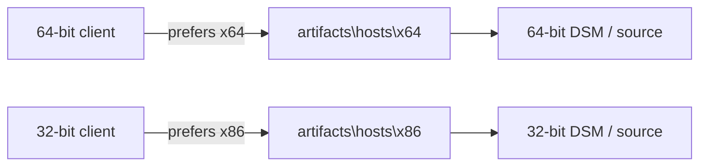

[All products](../) / [Saraff.Twain.Aux](./index.md)
# Getting Started

## Requirements

* Windows.
* .NET Framework 4.8 or .NET 8 (`net8.0-windows`) for the client and the host.
* Saraff.Twain 1.0.34, Saraff.IoC 2.0.0 and Saraff.Tiff 2.1.0.
* An installed TWAIN Data Source Manager and at least one TWAIN data source.
* Host and client must use the same `Saraff.Twain.Aux.Contracts` protocol major version
  (currently 2.3).

## Install

```powershell
dotnet add package Saraff.Twain.Aux
dotnet add package Saraff.Twain.Aux.Contracts
```

`Saraff.Twain.Aux` depends on `Saraff.Twain.Aux.Contracts`; the client only needs the contracts
when it builds request/response objects or implements its own transport.

### net48 and Saraff.IoC

Saraff.IoC 2.0.0 ships a legacy `net40` asset that NuGet can select for `net48`. That asset does
not support the new registration/scopes API. The package ships
`buildTransitive/Saraff.Twain.Aux.targets`, which injects the `netstandard2.0` Saraff.IoC assembly
for `net48` consumers. A normal `PackageReference` is enough; the source projects use the same
workaround.

## 1. Create the host executable

The host is a normal console executable with an STA entry point. It owns the TWAIN session and
serves JSON-RPC over stdin/stdout.

```csharp
using System.Threading;
using Saraff.Twain.Aux.Host;

internal static class Program
{
    [STAThread]
    private static void Main()
    {
        TwainAuxHost.RunAsync(new HostOptions
        {
            TwainPackageVersion = "1.0.34",
            // DsmPath = @"C:\Windows\System32\TWAINDSM.dll",
            // NativeFormat = NativeImageFormat.Bmp,
            // TransferDirectory = @"C:\ProgramData\MyApp\transfers"
        }).GetAwaiter().GetResult();
    }
}
```

The host project should target `net48` or `net8.0-windows` and enable Windows Forms
(`<UseWindowsForms>true</UseWindowsForms>` for `net8.0-windows`).

`TwainAuxHost.RunAsync` performs the following steps:

1. Creates `StdioTransport` and protects stdout for the protocol stream.
2. Starts `StaDispatcher` on a dedicated STA thread with a WinForms message pump.
3. Creates the root `ServiceContainer` and registers `HostOptions`, `StaDispatcher` and the
   `TransferSession`.
4. Registers `IStreamProvider` (`NamedPipeStreamProvider`) and `IImageHandler`
   (`BmpImageHandler` or `TiffImageHandler`).
5. Loads TIFF codec plugins and registers `ITiffCompressionService`.
6. Creates the real `Twain32` on the STA thread and sets `Twain32.Site` to `AuxServiceSite`.
7. Starts the JSON-RPC endpoint and waits for the client to disconnect.

The built-in `RunAsync` overload also accepts an `Action<ServiceContainer>` callback for extra
registrations.

## 2. Build both host bitnesses

TWAIN drivers are bitness-specific. Build `x86` and `x64` hosts from the repository:

```powershell
powershell -ExecutionPolicy Bypass -File .\build-hosts.ps1
```

The script produces:

```text
artifacts\hosts
├── x64\Saraff.Twain.Aux.Sample.Host.exe
└── x86\Saraff.Twain.Aux.Sample.Host.exe
```



Point `TwainAuxClientOptions.HostPath` to either:

* a specific host executable, or
* the `artifacts\hosts` directory.

When `HostPath` is a directory, the client tries the directory matching the current process
bitness first and the other architecture as a fallback. `HostExecutableName` controls the executable
name inside the architecture directory.

## 3. Connect from the client

```csharp
using System;
using System.Linq;
using System.Threading;
using Saraff.Twain.Aux.Client;
using Saraff.Twain.Aux.Contracts;

await using var client = await TwainAuxClient.ConnectAsync(new TwainAuxClientOptions
{
    HostPath = @"C:\Apps\MyApp\hosts",
    HostExecutableName = "Saraff.Twain.Aux.Sample.Host.exe",
    ConnectTimeout = TimeSpan.FromSeconds(15),
    NativeFormat = NativeImageFormat.Bmp,
    TransferDirectory = @"C:\ProgramData\MyApp\transfers"
});

Console.WriteLine($"Protocol: {client.Info.ProtocolVersion}");
Console.WriteLine($"Bitness:  {client.Info.Bitness}");
Console.WriteLine($"TWAIN:    {client.Info.TwainPackageVersion}");
Console.WriteLine($"Codecs:   {string.Join(", ", client.Info.TiffCompressions.Select(x => x.Name))}");
```

`ConnectAsync` starts the host process, creates the JSON-RPC connection and performs the `HelloAsync`
handshake. The `Info` property contains the host protocol version, aux version, TWAIN package
version, bitness, user SID, DSM path, feature flags and supported TIFF codecs.

## 4. List sources

```csharp
await client.OpenDsmAsync();
try
{
    foreach (var source in await client.GetSourcesAsync())
    {
        Console.WriteLine($"[{source.Index}] {source.ProductName} (TWAIN 2: {source.IsTwain2Compatible})");
    }
}
finally
{
    await client.CloseDsmAsync();
}
```

## 5. Acquire an image

```csharp
client.TransferCompleted += (_, result) =>
{
    if (result.Error is not null)
    {
        Console.Error.WriteLine(result.Error);
        return;
    }

    Console.WriteLine($"Mode={result.Mode} Format={result.Format} Pages={result.PageCount} " +
                      $"Bytes={result.Data?.LongLength ?? 0}");
    result.Image?.Save("scan.png");
};

await client.OpenDsmAsync();
try
{
    await client.Host.SetDefaultSourceAsync(new SetSourceRequest { Index = 0 }, default);

    if (!await client.OpenDataSourceAsync())
    {
        throw new InvalidOperationException("Failed to open the data source.");
    }

    try
    {
        await client.AcquireAsync(new AcquireRequest
        {
            Mode = TransferMode.Native,
            ShowUI = true,
            DisableAfterAcquire = true,
            Transfer = new TransferOptions
            {
                NativeFormat = NativeImageFormat.Bmp
            }
        });

        var result = client.LastTransfer
            ?? throw new InvalidOperationException("No transfer result was produced.");

        Console.WriteLine($"Last transfer: {result.Mode}, {result.PageCount} page(s)");
    }
    finally
    {
        await client.CloseDataSourceAsync();
    }
}
finally
{
    await client.CloseDsmAsync();
}
```

`TwainAuxClient.LastTransfer` contains the automatically assembled result. The
`TransferCompleted` event fires once per result, including errors. Events are raised on the RPC
callback thread; marshal to WinForms/WPF with `BeginInvoke`/`Dispatcher` before touching UI.

> **TWAIN 1.x note.** In a 32-bit process `Saraff.Twain` defaults to TWAIN 1.x. In that mode
> `SetDefaultSource` can fail with `DG DAT MSG out of expected sequence`. Use the default source
> with `OpenDataSource()`, or use `SelectSource()` (UI), or enable TWAIN 2.x in the host when the
> source supports it.

## 6. Choose the transfer mode

| Mode | Use it when |
|---|---|
| `Native` | The source supports native transfer; the client receives BMP/TIFF over a named pipe. |
| `Memory` | The source produces memory chunks; the client assembles BMP or concatenates data. |
| `MemoryTiff` | The source produces uncompressed chunky chunks and you want a host-built TIFF. |
| `MemoryMultipageTiff` | The source supports ADF/multi-page and you want one multi-page TIFF. |
| `MemFile` | The source uses memory-file transfer; the data is saved to the transfer directory. |
| `File` | The source supports file transfer; the host writes a file and the client reads/deletes it. |
| `Auto` | Let the source use its default transfer mechanism. |

See [Transfers](./Transfers.md) for the exact flows, limits and TIFF compression options.

## 7. Troubleshooting the first run

| Symptom | Likely cause |
|---|---|
| `HostPath is required` | Neither `HostPath` nor `TransportFactory` is set. |
| `Host executable not found under the architecture directories` | `HostPath` points to a directory without `x64`/`x86` host builds. |
| Handshake `Protocol mismatch` | Host and client use different protocol major versions. |
| No sources | The host bitness does not match the installed DSM/source, or no TWAIN source is installed. |
| Source opens but no UI appears | The host is running in session 0 or on a non-interactive desktop. See [Service Hosting](./ServiceHosting.md). |
| Native transfer fails | The named pipe could not be created or read; check the error and the memory fallback. |
| `SetDefaultSource` fails on x86 | TWAIN 1.x limitation; use `OpenDataSource` or TWAIN 2.x. |

## Next

* [Architecture](./Architecture.md) — processes, components and threading
* [Protocol](./Protocol.md) — wire protocol, RPC methods and callbacks
* [Transfers](./Transfers.md) — transfer modes, pipes and TIFF codecs
* [Build and Test](./BuildAndTest.md) — build, pack and validation
