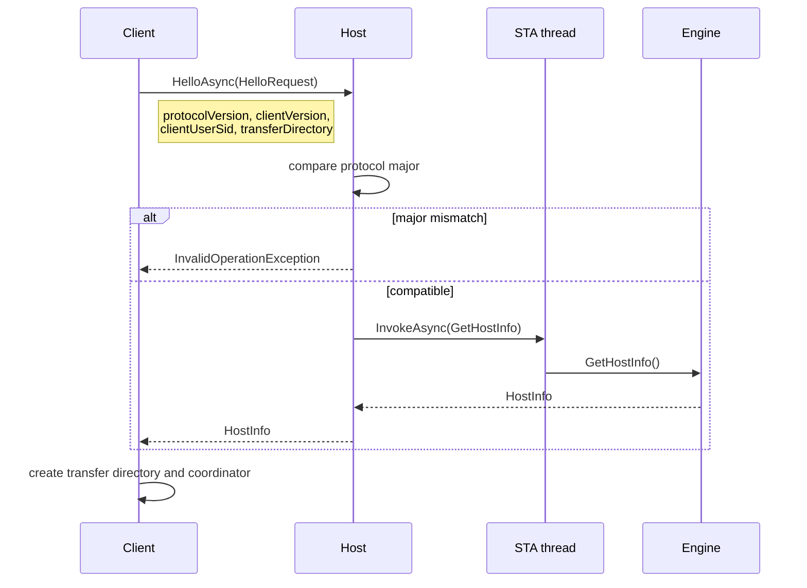
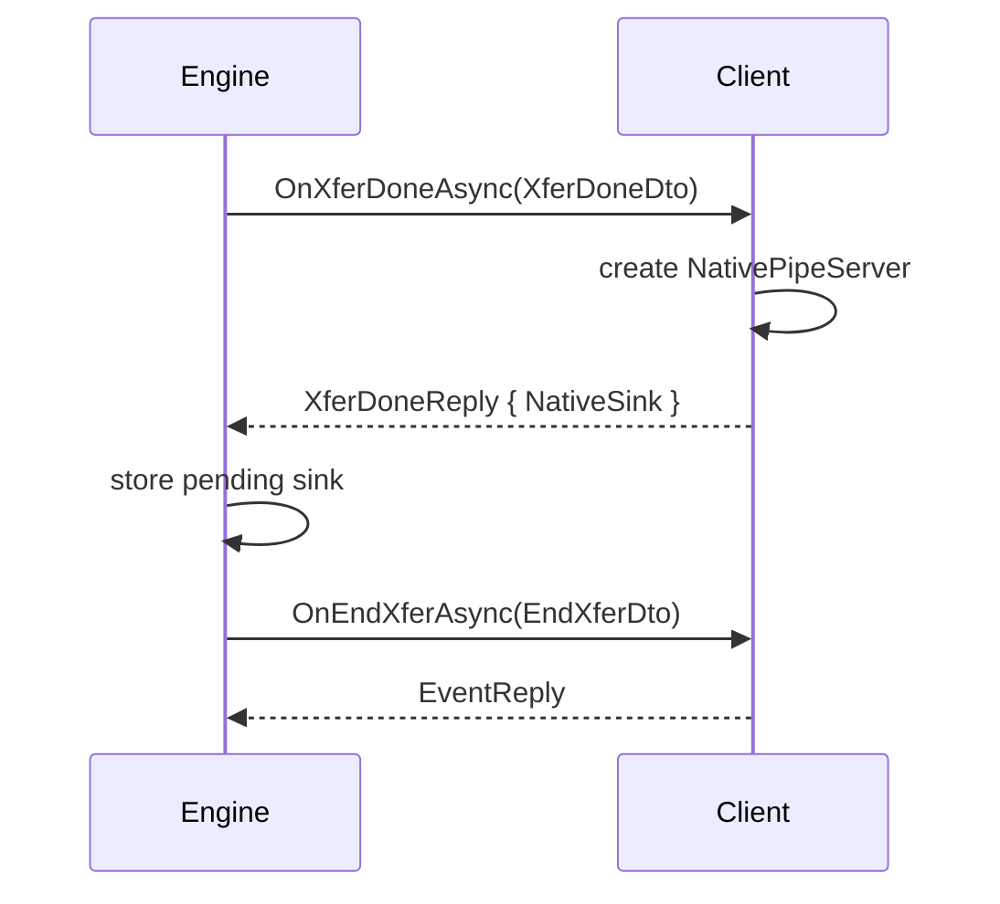
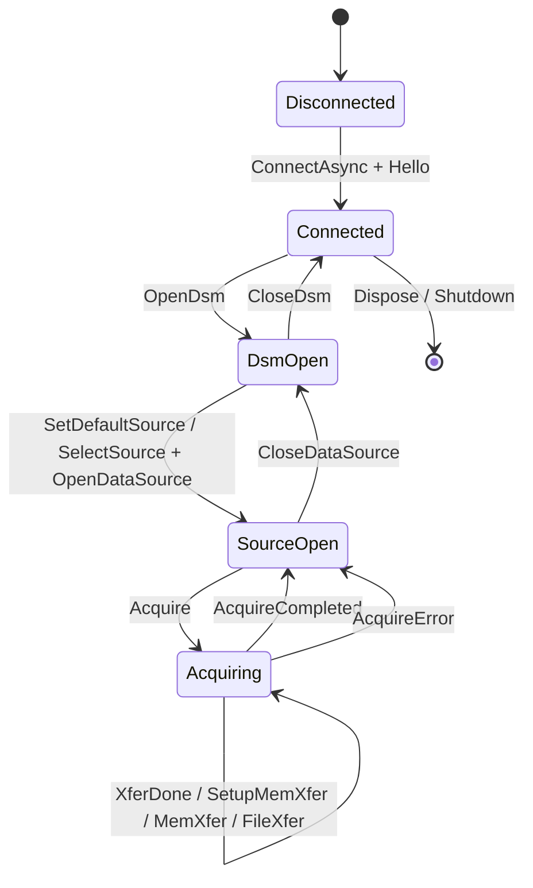

[All products](../) / [Saraff.Twain.Aux](./index.md)
# Protocol

The host and client communicate over a local duplex byte stream. The default transport is the
host's redirected stdin/stdout; tests use an in-memory pipe pair.

## Wire format

* **JSON-RPC 2.0** messages framed by `StreamJsonRpc.LengthHeaderMessageHandler`.
* Each frame starts with a `Content-Length` header, followed by an empty line, followed by the
  UTF-8 JSON body.
* Serialization uses `System.Text.Json` with web defaults:
  * camelCase property names;
  * `null` properties omitted;
  * enums written as strings;
  * `byte[]` values base64-encoded by STJ.
* Cancellation uses the StreamJsonRpc `$/cancelRequest` notification rather than a serialized
  field.

```text
Content-Length: <n>\r\n
\r\n
{"jsonrpc":"2.0","id":1,"method":"HelloAsync","params":[{"protocolVersion":"2.3"}]}
```

`<n>` is the UTF-8 byte length of the JSON body, including any trailing whitespace.

The host reserves **stdout** for JSON-RPC. `StdioTransport` redirects `Console.Out` to stderr so
host/user logging cannot corrupt the protocol stream.

## Versioning

`AuxProtocol` defines the compatibility version:

| Field | Value |
|---|---|
| Major | 2 |
| Minor | 3 |
| `AuxProtocol.Version` | `2.3` |

The handshake validates only the **major** version. A host and client with different major versions
fail immediately; a different minor version is accepted.

## Handshake



`HelloRequest` carries:

| Field | Meaning |
|---|---|
| `ProtocolVersion` | Client protocol version, default `AuxProtocol.Version` |
| `ClientVersion` | Client assembly version |
| `ClientUserSid` | Current client Windows user SID, used for pipe/file ACLs |
| `TransferDirectory` | Optional client-proposed transfer directory |

`HostInfo` returns:

| Field | Meaning |
|---|---|
| `ProtocolVersion` | Host protocol version |
| `AuxVersion` | `Saraff.Twain.Aux` assembly version |
| `TwainPackageVersion` | Expected Saraff.Twain package version |
| `TwainAssemblyVersion` | Loaded `Saraff.Twain` assembly version |
| `Bitness` | `x64` or `x86` |
| `UserSid` | Host process user SID |
| `DsmPath` | Effective DSM path, if overridden |
| `Features` | `AuxFeatures` flags |
| `TiffCompressions` | Supported TIFF codecs and built-in/plugin flag |

## Feature flags

`HostInfo.Features` is an `AuxFeatures` bit mask:

| Flag | Value | Meaning |
|---|---|---|
| `NativeTransfer` | 1 | Native BMP/TIFF transfer over a named pipe |
| `MemoryTransfer` | 2 | TWAIN memory chunk transfer |
| `FileTransfer` | 4 | TWAIN file transfer |
| `MemFile` | 8 | TWAIN memory-file transfer |
| `DeviceEvent` | 16 | Source device events are forwarded |
| `DsmPath` | 32 | Host supports an explicit DSM path |
| `MemoryTiff` | 64 | Host assembles a TIFF from memory chunks |
| `MemoryMultipageTiff` | 128 | Host assembles a multi-page TIFF |
| `TiffCompression` | 256 | Host can compress TIFF output |

The real `Twain32Engine` reports all flags. A fake engine used in tests can report a subset, and
the client rejects `MemoryTiff`/`MemoryMultipageTiff` requests when the corresponding flag is
missing.

## RPC surface

All methods are on `ITwainHost` and take a request object plus a `CancellationToken`. All TWAIN
operations are marshaled to the host's STA dispatcher.

### Session and sources

| Method | Result |
|---|---|
| `HelloAsync(HelloRequest)` | `HostInfo` |
| `OpenDsmAsync(EmptyRequest)` | — |
| `CloseDsmAsync(EmptyRequest)` | — |
| `GetSourcesAsync(EmptyRequest)` | `SourceInfo[]` |
| `GetDefaultSourceAsync(EmptyRequest)` | Index |
| `SetDefaultSourceAsync(SetSourceRequest)` | — |
| `SelectSourceAsync(EmptyRequest)` | `bool` |
| `OpenDataSourceAsync(EmptyRequest)` | `bool` |
| `CloseDataSourceAsync(EmptyRequest)` | `bool` |
| `GetStateAsync(EmptyRequest)` | `HostState` |
| `ShutdownAsync(EmptyRequest)` | — |

### Capabilities

| Method | Result |
|---|---|
| `GetCapabilityAsync(CapabilityRequest)` | `CapabilityValue` |
| `SetCapabilityAsync(SetCapabilityRequest)` | — |
| `ResetCapabilityAsync(CapabilityRequest)` | — |
| `ResetAllCapabilitiesAsync(EmptyRequest)` | — |
| `IsCapabilitySupportedAsync(CapabilityRequest)` | TWAIN support value as `int` |

`CapabilityRequest.Name` is a `Saraff.Twain.TwCap` enum name, for example `IXferMech`,
`XResolution`, `YResolution`, `PixelType` or `PixelFlavor`.

| Operation | Use |
|---|---|
| `Get` | Current capability container |
| `GetCurrent` | Current value |
| `GetDefault` | Default value |
| `Set` | Set one value or a range/array |
| `SetConstraint` | Set a constraint range/array |
| `Reset` | Reset one capability |
| `ResetAll` | Reset all capabilities |
| `IsSupported` | Query support |

`CapabilityValue.Kind` tells the client which payload field is populated: `BoolValue`,
`IntValue`, `FloatValue`, `StringValue`, `ArrayValues`, `FloatArrayValues`, `Range` or
`Rectangle`. Enum values are returned as both an integer and a string name.

### Acquisition and images

| Method | Result |
|---|---|
| `AcquireAsync(AcquireRequest)` | — (events carry progress) |
| `CancelAcquireAsync(EmptyRequest)` | — |
| `GetImageInfoAsync(EmptyRequest)` | `ImageInfoDto` |
| `GetExtImageInfoAsync(EmptyRequest)` | `ExtImageInfoDto[]` |
| `GetImageBytesAsync(ImageIndexRequest)` | `byte[]` |
| `GetImageFileAsync(ImageIndexRequest)` | `FileInfoDto` |

### Sources, palette and diagnostics

| Method | Result |
|---|---|
| `GetSourceProductNameAsync(SourceIndexRequest)` | Product name |
| `GetSourceIdentityAsync(SourceIndexRequest)` | `SourceIdentityDto` |
| `GetIsSourceTwain2CompatibleAsync(SourceIndexRequest)` | `bool` |
| `GetPaletteAsync(EmptyRequest)` | `ColorPaletteDto` |
| `GetDefaultPaletteAsync(EmptyRequest)` | `ColorPaletteDto` |
| `SetPaletteAsync(SetPaletteRequest)` | — |
| `ResetPaletteAsync(SetPaletteRequest)` | — |

## Callbacks

The host calls `ITwainClientCallbacks` on the client. The client must reply to callback methods
that return a reply object; a `Cancel` flag aborts the current TWAIN operation where applicable.

| Callback | Reply | When |
|---|---|---|
| `OnXferDoneAsync(XferDoneDto)` | `XferDoneReply` | Image metadata is ready; native sink can be supplied |
| `OnEndXferAsync(EndXferDto)` | `EventReply` | A transfer completed |
| `OnSetupMemXferAsync(SetupMemXferDto)` | `SetupMemXferReply` | Memory transfer is being set up |
| `OnMemXferAsync(MemChunkDto)` | `EventReply` | A memory chunk arrived |
| `OnMemTiffCompletedAsync(MemTiffCompletedDto)` | — | Host finished a single-page/multi-page TIFF |
| `OnMemMultipageTiffReadyAsync(MemTiffReadyDto)` | — | Multi-page TIFF is ready; client starts pipe read |
| `OnSetupFileXferAsync(SetupFileXferDto)` | `SetupFileXferReply` | File transfer path is requested |
| `OnFileXferAsync(FileXferDto)` | `EventReply` | File transfer completed |
| `OnTwainStateChangedAsync(TwainStateDto)` | — | TWAIN state flags changed |
| `OnAcquireCompletedAsync(AcquireCompletedDto)` | — | Acquisition completed |
| `OnAcquireErrorAsync(AcquireErrorDto)` | — | TWAIN or engine error |
| `OnDeviceEventAsync(DeviceEventDto)` | — | Source device event |
| `OnLogAsync(LogDto)` | — | Reserved log channel; the current engine writes host diagnostics to `Trace` |

For native transfer, the key exchange is:



If the client replies `Cancel = true`, the engine cancels the current `XferDone`/`EndXfer` and
`AcquireAsync` unwinds. A callback failure also sets an internal abort flag and is reported through
`OnAcquireErrorAsync` where possible.

## Session state



`GetStateAsync` returns `HostState`:

| Field | Meaning |
|---|---|
| `IsDsmOpen` | DSM was opened through the host |
| `IsSourceOpen` | A data source is open |
| `IsAcquiring` | Reserved; the current engine reports `false` |
| `ImageCount` | `Twain32.ImageCount` |
| `DsmPath` | Effective DSM path |

`IsAcquiring` is not tracked by `Twain32Engine` in 2.0 and should not be used as a reliable
acquisition flag. Use the `AcquireCompleted` and `AcquireError` events instead.

## Errors and cancellation

* Host-side exceptions cross the RPC boundary as `RemoteInvocationException` and are rethrown as
  `TwainRemoteException` with the remote message.
* TWAIN acquisition failures can also arrive as `OnAcquireErrorAsync` with a `TwainErrorDto`
  (`Type`, `Message`, optional `TwRC`/`TwCC`).
* `CancelAcquireAsync` sets an engine flag. Saraff.Twain 1.0.34 has no thread-agnostic cancel API,
  so the flag is delivered through the next transfer event (`XferDone`, `MemXfer`,
  `SetupFileXfer`, ...). An already-open modal DSM UI may still need to be closed by the user.
* Request cancellation is passed to the RPC call; a cancelled request does not necessarily
  interrupt an in-progress TWAIN operation.

## Next

* [Transfers](./Transfers.md) — transfer modes, pipes and TIFF codecs
* [Service Hosting](./ServiceHosting.md) — launch modes and security
* [API Reference](./ApiReference.md) — public types and members
