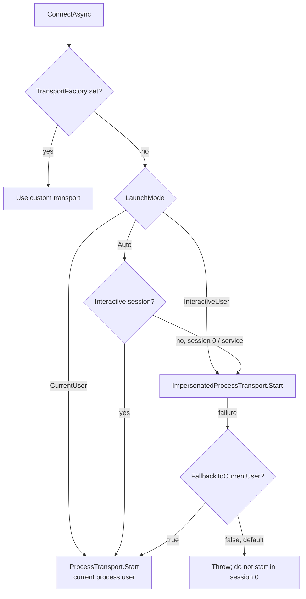
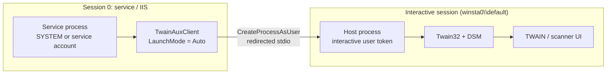
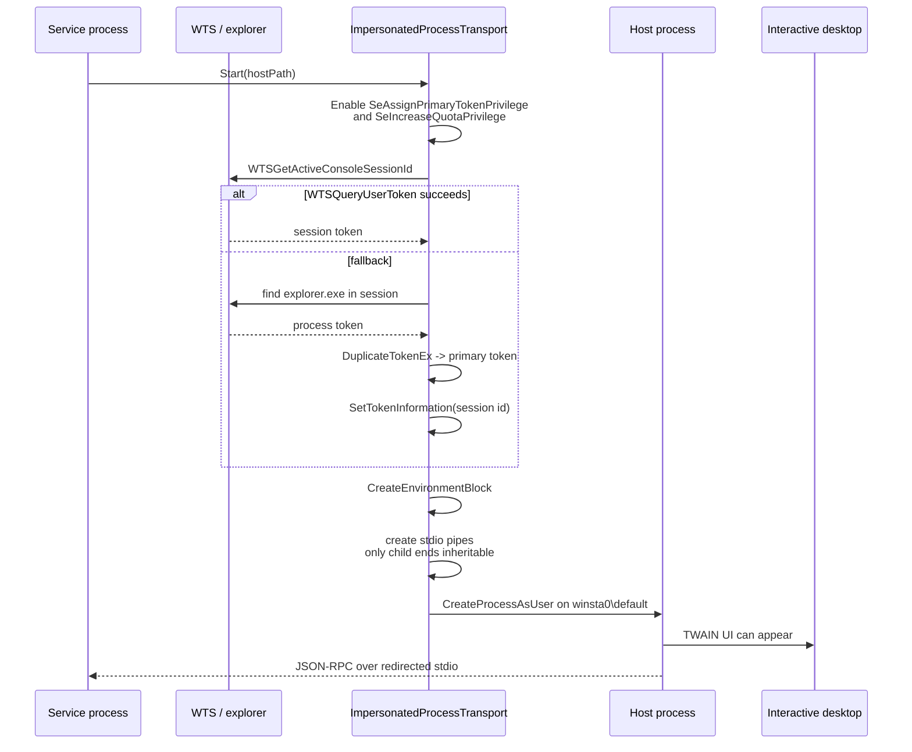
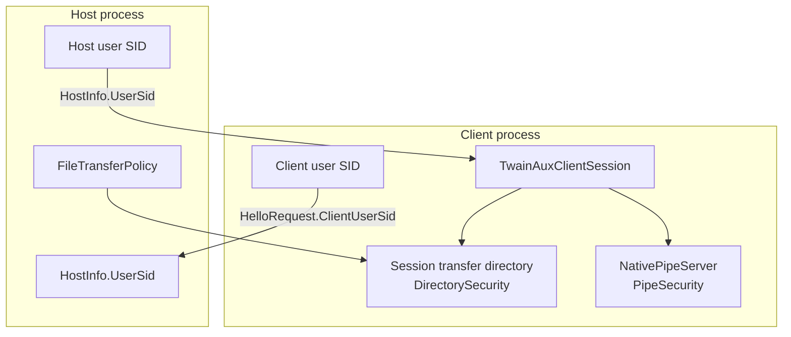

[All products](../) / [Saraff.Twain.Aux](./index.md)
# Service Hosting

TWAIN and the DSM UI require an interactive desktop. A Windows service, IIS application or other
session-0 process cannot show TWAIN UI directly. `Saraff.Twain.Aux` solves this by starting the
host as the interactive desktop user.

## Launch modes

`TwainAuxClientOptions.LaunchMode` selects how the host process starts.



| Mode | Behavior |
|---|---|
| `Auto` (default) | Interactive session -> current user. Non-interactive/session 0 -> interactive desktop user |
| `CurrentUser` | Always start as the current process user |
| `InteractiveUser` | Always use the interactive desktop user (useful for testing from a console) |

`FallbackToCurrentUser` is `false` by default. A service should fail clearly instead of starting a
host in session 0 where TWAIN UI cannot appear. Set it to `true` only for non-UI scenarios.

The interactive-session check is:

```csharp
Environment.UserInteractive && Process.GetCurrentProcess().SessionId != 0
```

## Service path



The service keeps the client side. The host starts on the interactive window station and desktop,
so the DSM and scanner dialogs are visible to the logged-in user.

## Impersonation sequence

`ImpersonatedProcessTransport.Start` uses `CreateProcessAsUser` with a primary token for the active
console session.



Key details:

* The active console session must exist (`WTSGetActiveConsoleSessionId` must not return
  `0xFFFFFFFF`).
* `WTSQueryUserToken` is tried first; if it fails, the transport duplicates the token of
  `explorer.exe` in the active session.
* The host is started with `STARTF_USESTDHANDLES`, `winsta0\default`, hidden window and
  `CreateUnicodeEnvironment | CreateNoWindow`.
* Parent pipe ends are made non-inheritable; only the child stdin/stdout/stderr ends are passed to
  the child. This fixes the classic parent/child pipe-inheritance problem.
* The service must be allowed to assign a primary token and increase quota. LocalSystem normally
  has both privileges; a restricted service account may not.

## Security model



| Resource | Access |
|---|---|
| JSON-RPC stream | Child-process stdin/stdout; no network listener |
| Named pipe server | Client user full control; host user read/write when SIDs differ |
| Transfer directory | Client user full control; host user modify when SIDs differ |
| File-transfer root | Host user full control; client user modify when SIDs differ |
| File paths | Must stay inside the allowed root; reparse points rejected |

The client and host exchange their SIDs during `HelloAsync`. The client passes its SID to the host,
and `HostInfo.UserSid` tells the client which SID the host runs as. If both processes run as the
same user, the extra ACL entries are skipped.

### File path policy

`FileTransferPolicy` is intentionally strict:

* A requested path is normalized with `Path.GetFullPath`.
* A path outside the root is replaced with a generated `scan-<index>-<guid>.<ext>` path.
* Every parent directory is checked for `FileAttributes.ReparsePoint`; symlink/junction traversal
  is rejected.
* The generated file is tracked and removed by `Cleanup` on the next acquisition or host dispose.

The extension is derived from the TWAIN file format (`BMP`, `TIFF`/`TIF`, `JPEG`/`JPG`, `PNG`) and
falls back to `.img`.

## Service checklist

Run an elevated PowerShell probe:

```powershell
powershell -ExecutionPolicy Bypass -File .\scripts\test-service-impersonation.ps1
```

Expected result:

```text
OK protocol=2.3 bitness=x64 userSid=S-1-5-21-... dsmOpen=False
```

`userSid` must be the interactive user's SID, not `S-1-5-18` (SYSTEM). The probe performs a
handshake and a state request; it does not scan. Add an acquisition to the probe for full service
UI validation.

Checklist:

- The host executable and its dependencies are readable/executable by both the service account
  and the interactive user.
- The service account can use `SeAssignPrimaryTokenPrivilege` and `SeIncreaseQuotaPrivilege`.
- An interactive user is logged on to the console session.
- The host starts on `winsta0\default`; `ShowUI = true` can display the DSM UI.
- The named-pipe ACL contains both the client and host SIDs.
- The transfer directory DACL contains both SIDs.
- `FallbackToCurrentUser` stays `false` for UI scenarios.

## Limitations

* Session 0 has no interactive desktop; a host started there cannot show TWAIN UI.
* `CancelAcquireAsync` cannot close an already-open modal DSM dialog; the user may need to close it.
* The impersonation transport uses `STARTUPINFO` handle inheritance. A future hardening step is a
  `STARTUPINFOEX` explicit handle list.
* Real cross-user ACL validation requires two different user accounts.
* Physical scanner multi-page feeding requires hardware; CI covers protocol/transfer tests with a
  fake engine.

## Next

* [Transfers](./Transfers.md) — named pipes, file policy and limits
* [Build and Test](./BuildAndTest.md) — service probe and validation commands
* [Protocol](./Protocol.md) — handshake and SID exchange
