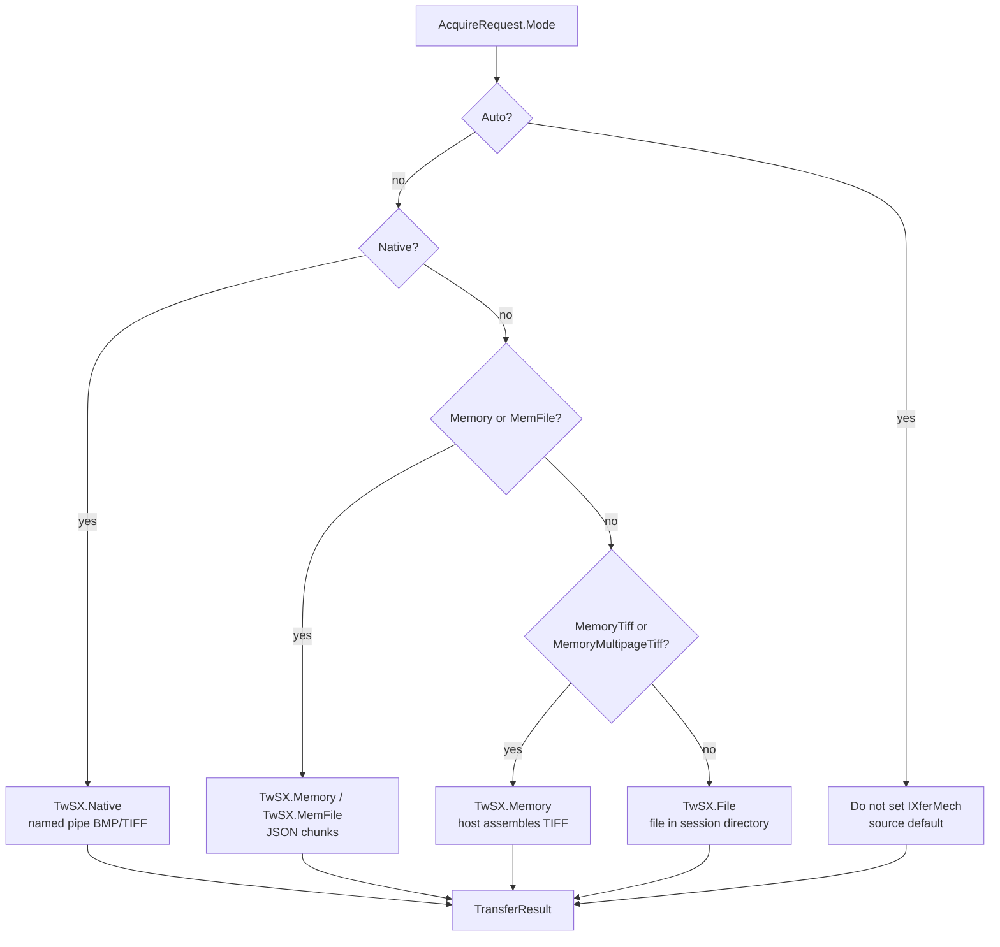
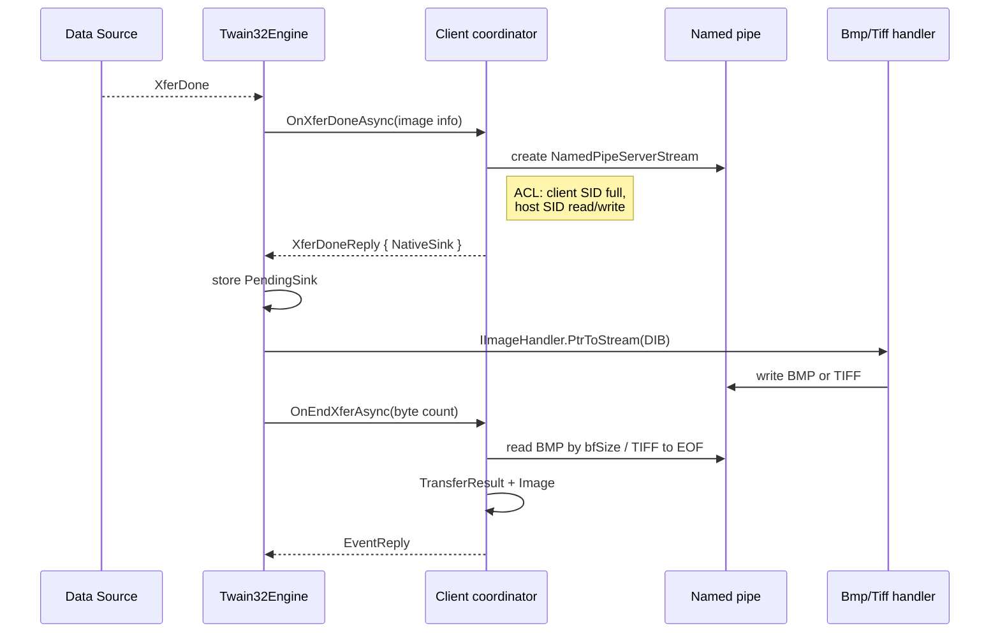
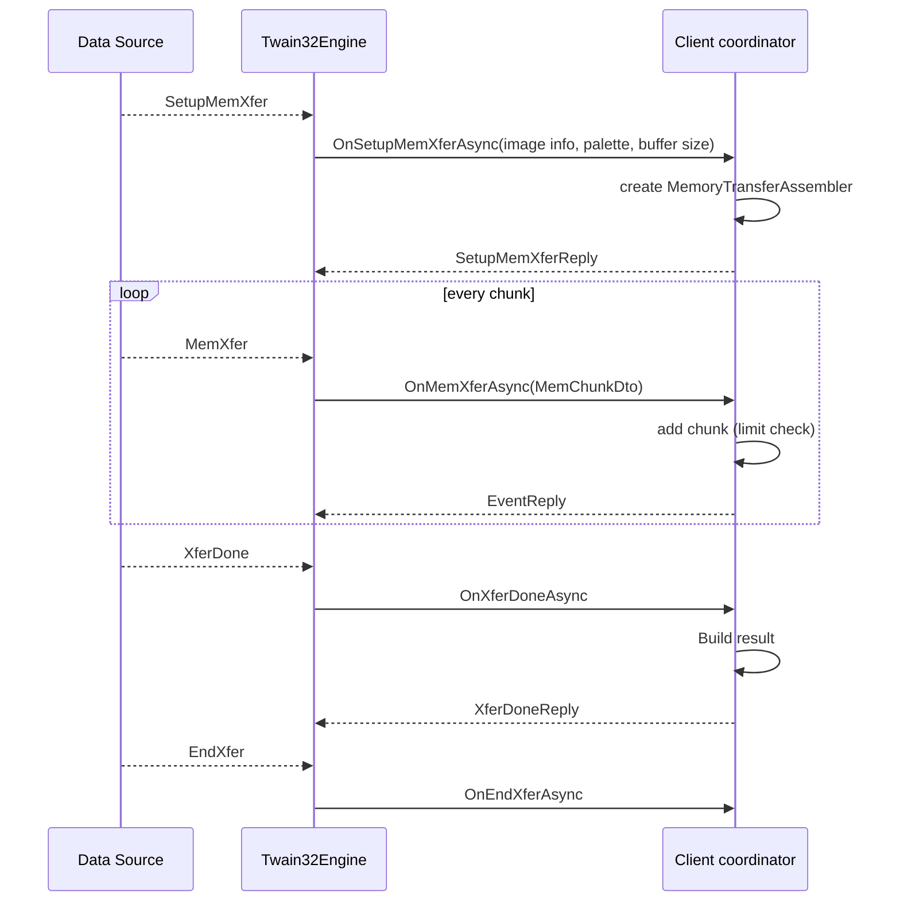
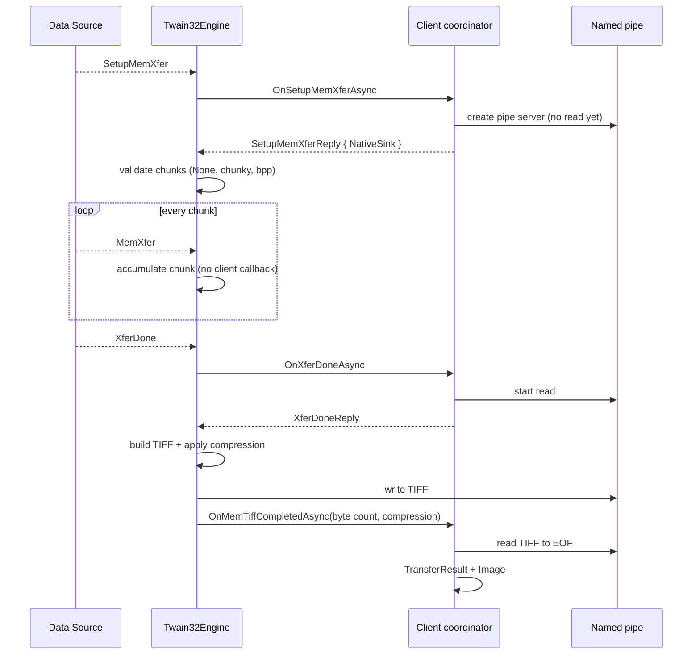
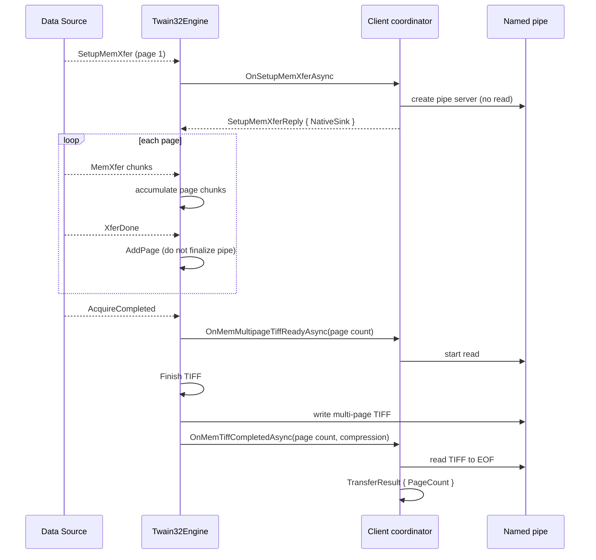
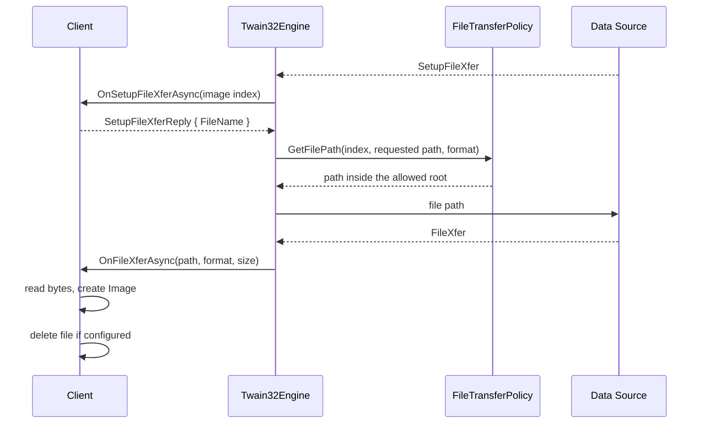
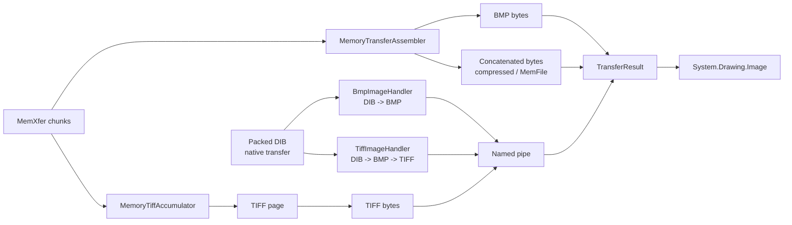
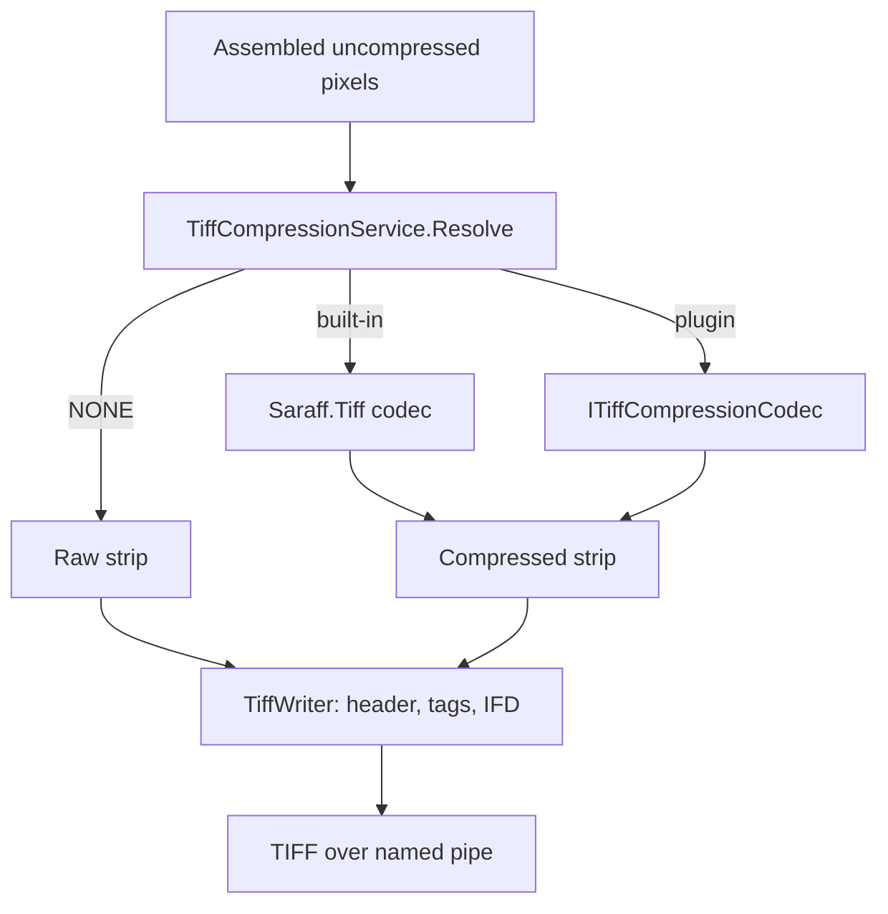

[All products](../) / [Saraff.Twain.Aux](./index.md)
# Transfers

The host exposes six transfer modes plus `Auto`. The mode controls the TWAIN transfer mechanism
(`IXferMech`) and how the image bytes reach the client.

## Mode selection



| Mode | TWAIN mechanism | Payload path | Client materialization |
|---|---|---|---|
| `Auto` | Source default | Depends on source events | Depends on events |
| `Native` | `TwSX.Native` | Named pipe, BMP or TIFF | BMP by `bfSize`, TIFF to EOF |
| `Memory` | `TwSX.Memory` | JSON chunks (base64) | BMP assembly or concatenation |
| `MemoryTiff` | `TwSX.Memory` | Host-built TIFF over a named pipe | TIFF bytes to `Image` |
| `MemoryMultipageTiff` | `TwSX.Memory` | One multi-page TIFF over a named pipe | TIFF bytes to `Image` |
| `MemFile` | `TwSX.MemFile` | JSON chunks concatenated to a file | File bytes and `Image` |
| `File` | `TwSX.File` | File in a validated directory | Read/delete and `Image` |

`TransferMode.Auto` does not call `SetCap(IXferMech)`; the source chooses its default mechanism.

## Native transfer

Native transfer is the default for sources that support it. The **client creates the pipe server**
during `XferDone`; the **host connects as the pipe client** through `IStreamProvider`.



### BMP framing

For `NativeImageFormat.Bmp` the client reads a 14-byte `BITMAPFILEHEADER`:

* bytes 0-1 must be `BM`;
* `bfSize` (bytes 2-5) is the total file size;
* the client reads exactly `bfSize` bytes and rejects sizes below 14 or above
  `MaxNativeImageBytes`.

### TIFF framing

For `NativeImageFormat.Tiff` the host writes a TIFF stream. The pipe has no length prefix, so the
client reads to EOF and enforces `MaxNativeImageBytes`.

### Image handlers

| Format | Handler | Conversion |
|---|---|---|
| `Bmp` | `BmpImageHandler` | Packed DIB pointer -> BMP file header + DIB bytes |
| `Tiff` | `TiffImageHandler` | DIB -> BMP in memory -> `System.Drawing.Bitmap` -> TIFF |

Both handlers obtain their output stream from `IStreamProvider`. `NamedPipeStreamProvider` returns
the pending pipe when one is present and falls back to a `MemoryStream` otherwise.

### Memory fallback

If the client cannot create the pipe during `XferDone`, the coordinator marks a native fallback and
fetches the image through `GetImageBytesAsync`. The host returns `TransferSession.LastNativeBytes`
when the native handler wrote to a memory stream. A result can therefore contain an error such as
`Native pipe setup failed: ...` while a later fallback result succeeds. A read failure after a
successful pipe setup produces an error result instead of the fallback.

If the application sets `XferDoneEventArgs.NativeSink` itself, the automatic coordinator does not
read that pipe; the application is responsible for consuming it.

## Memory transfer

Memory transfer sends TWAIN chunks as JSON DTOs. `byte[]` data is base64-encoded by
`System.Text.Json`.



The assembler has two paths:

* **BMP assembly** when the image is uncompressed (`ImageInfo.Compression == 0`) and
  `BitsPerPixel >= 8`. Chunks are copied by `XOffset`/`YOffset` into a bottom-up BMP with stride
  `((width * bpp + 31) / 32) * 4`.
* **Concatenation** for `MemFile`, compressed data or images below 8 bpp. Chunks are ordered by
  `ChunkIndex` and concatenated.

For 8 bpp images the palette from the TWAIN `Palette` capability is written to the BMP color table.
If no palette is available, a grayscale palette is generated.

## MemoryTiff

`MemoryTiff` uses `TwSX.Memory`, but the host assembles the TIFF and sends it through a named pipe.
This avoids sending every chunk to the client as JSON.



TWAIN MemXfer chunks must still be **uncompressed** (`TwCompression.None`) and chunky. The host
does not decode compressed TWAIN chunks. Compression is applied by the host when writing the TIFF.

Validation performed by `MemoryTiffPageBuilder`:

| Check | Rejected with |
|---|---|
| `ImageInfo.Compression != 0` | `NotSupportedException` |
| planar layout (`PlanarChunky != 0`) | `NotSupportedException` |
| `BitsPerPixel < 8` | `NotSupportedException` |
| chunks do not cover the complete image | assembly error |
| total bytes exceed the limit | assembly error |
| TIFF compression fails | assembly error |

Supported bpp: 8, 16, 24, 32, 48 and 64.

`MemoryTiff` produces one TIFF per image. Use `MemoryMultipageTiff` when all pages must be in a
single file.

## MemoryMultipageTiff

`MemoryMultipageTiff` is the same chunk path as `MemoryTiff`, but the host keeps every page and
writes one multi-page TIFF at `AcquireCompleted`.



* `XferDone` finalizes only the current page.
* `AcquireCompleted` is the end of the whole acquisition.
* `TransferResult.PageCount` reports the number of pages.
* The size limit applies to the complete multi-page TIFF.

## MemFile

`MemFile` uses `TwSX.MemFile`. The client concatenates chunks and writes them to a file in the
session transfer directory:

```text
<transfer directory>\memfile-<image index>-<guid>.bin
```

The result contains `Data`, `Image` (when the bytes are a supported image format) and `FilePath`.
`IsMemFile` is `true`. Some sources do not support MemFile; the virtual Saraff Screen DS is one
example (`Data parameter out of range` when setting `IXferMech`).

## File transfer

File transfer lets the TWAIN source write a file. The host validates the path and the client reads
and optionally deletes it.



`FileTransferPolicy`:

* uses the requested directory, the host fallback directory, or
  `%TEMP%\Saraff.Twain.Aux\<guid>`;
* creates the directory and applies a DACL for the host user (full control) and the client SID
  (modify), when they differ;
* rejects a requested path outside the root and regenerates a safe path;
* rejects paths that traverse a reparse point (symlink/junction);
* tracks created files and deletes them on cleanup.

The client deletes a transferred file when `DeleteTransferredFiles` is `true` and the path is inside
its own session transfer directory.

## Limits and timeouts

| Setting | Default | Used by |
|---|---|---|
| `TwainAuxClientOptions.MaxNativeImageBytes` | 512 MiB | Native and TIFF pipe reads |
| `HostOptions.MaxNativeImageBytes` | 512 MiB | Host TIFF limit and TIFF fallback limit |
| `TwainAuxClientOptions.MaxMemoryImageBytes` | 256 MiB | Memory assembler |
| `TransferOptions.MaxMemoryBytes` | — | Per-acquisition memory override |
| `TransferOptions.MaxTiffBytes` | — | Per-acquisition TIFF limit |
| `TwainAuxClientOptions.PipeConnectTimeoutMs` | 30000 ms | Named pipe connect/read timeout |
| `TwainAuxClientOptions.ConnectTimeout` | 10 s | Handshake |
| `HostOptions.MaxMessageBytes` | 64 MiB | Reserved message limit setting |
| `HostOptions.ReadTimeoutMs`, `WriteTimeoutMs` | 60000 ms | Reserved transport timeout settings |

`TransferOptions.NativeFormat` selects BMP or TIFF for native transfer.
`TransferOptions.TransferDirectory` controls file placement. `TransferOptions.FilePath` and
`TransferOptions.MaxNativeImageBytes` are reserved fields. `TransferOptions.ClientUserSid`
is used for the file-transfer directory DACL when the client and host run as different users;
named-pipe ACLs use the SIDs exchanged during the handshake.

## Image and metadata pipeline



`XferDone` carries `ImageInfo` and `ExtImageInfo`. Extended info values are strings; byte arrays
are base64-encoded. `ImageInfoDto` includes dimensions, bpp, samples per pixel, compression,
pixel type, planar flag and resolution.

## TIFF compression and codecs

Host-side compression is available for `MemoryTiff` and `MemoryMultipageTiff`.

| Compression | Source |
|---|---|
| `NONE` | Built-in pass-through |
| `PACKBITS` | Built-in |
| `LZW` | Built-in |
| `ADOBE_DEFLATE` | Built-in |
| `DEFLATE` | Built-in |
| Custom | `Saraff.Tiff.Core.ITiffCompressionCodec` plugin |

`HostInfo.TiffCompressions` reports the codecs available in the running host. The client validates
`TransferOptions.TiffCompression` against that list before sending the request; the host also
resolves the codec and throws `NotSupportedException` for an unknown name.



### External codec plugins

1. Implement `Saraff.Tiff.Core.ITiffCompressionCodec`.
2. Copy the plugin assembly into a `plugins` directory next to the host executable, or set
   `HostOptions.CodecPluginDirectory`.
3. Keep `Saraff.Tiff.dll`, `Saraff.Twain.dll`, `Saraff.Twain.Aux*.dll`, `Saraff.IoC*` and system
   assemblies out of the plugin directory; the host assemblies are used.
4. Restart the host. No host rebuild is required.

Plugin settings:

| Setting | Default | Meaning |
|---|---|---|
| `HostOptions.EnableCodecPlugins` | `true` | Scan the plugin directory |
| `HostOptions.CodecPluginDirectory` | `<host>\plugins` | Plugin location |
| `HostOptions.AllowCodecOverrides` | `false` | Allow a plugin to replace a registered codec |
| `HostOptions.ContinueOnCodecPluginError` | `false` | Skip a broken plugin instead of failing startup |

Custom codecs appear in `HostInfo.TiffCompressions` with `IsBuiltIn = false`.

## Result shape

`TransferResult` is the client-side outcome:

| Property | Meaning |
|---|---|
| `Mode` | Effective transfer mode |
| `Format` | BMP or TIFF |
| `Data` | Image bytes, when available |
| `Image` | Materialized `System.Drawing.Image`, when the bytes are decodable |
| `FilePath` | File path for `File`/`MemFile` |
| `ImageInfo` | Image metadata |
| `IsMemFile` | MemFile marker |
| `PageCount` | Page count for multipage TIFF, otherwise 1 |
| `TiffCompression` | Selected TIFF compression, for MemoryTiff modes |
| `Error` | Transfer error text, if the transfer failed |

## Next

* [Service Hosting](./ServiceHosting.md) — launch modes and security
* [API Reference](./ApiReference.md) — public types and members
* [Troubleshooting](./GettingStarted.md#7-troubleshooting-the-first-run) — first-run issues
