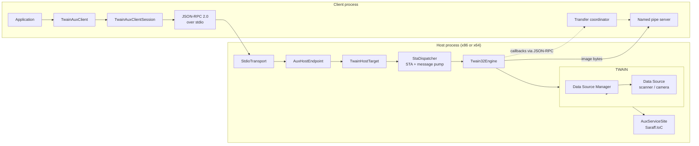

[All products](../)
# Saraff.Twain.Aux

**Saraff.Twain.Aux** is an out-of-process bridge for [Saraff.Twain.NET](../sarafftwain/index.md).
A small `Host` executable owns the real `Twain32` object on a dedicated STA thread and exposes it
to client processes over a JSON-RPC 2.0 stream. This keeps TWAIN/DSM problems out of 64-bit,
service, IIS and web processes and makes scanner access possible from applications that cannot
load the DSM themselves.

| | |
|---|---|
| **Packages** | [`Saraff.Twain.Aux`](https://www.nuget.org/packages/Saraff.Twain.Aux/), [`Saraff.Twain.Aux.Contracts`](https://www.nuget.org/packages/Saraff.Twain.Aux.Contracts/) |
| **Version** | 2.0.0 |
| **Aux target frameworks** | `net48`, `net8.0-windows` |
| **Contracts target** | `netstandard2.0` |
| **Protocol** | JSON-RPC 2.0, protocol version 2.3 |
| **Host process** | `x86` and `x64` executables built per TWAIN bitness |
| **Transfers** | Native, Memory, MemoryTiff, MemoryMultipageTiff, MemFile, File |
| **TWAIN dependency** | Saraff.Twain 1.0.34 |
| **License** | LGPL-3.0-or-later |

> **Aux is not a replacement for Saraff.Twain.NET.**
> It hosts `Twain32` in a separate process. The client works with the async
> `TwainAuxClient` API and with wire contracts from `Saraff.Twain.Aux.Contracts`.

## The model in one picture



The **host owns the TWAIN session** and all TWAIN calls. The **client owns the application-facing
API**, receives callbacks and, for native and TIFF transfers, creates the named pipe that receives
the image bytes.

## Why use an out-of-process host

* TWAIN is bitness-specific: a 64-bit application needs a 64-bit DSM and a 32-bit source needs a
  32-bit host, so both host variants can be deployed side by side.
* TWAIN and the DSM UI require an interactive desktop. A Windows service can start the host as the
  interactive user with `CreateProcessAsUser`.
* The TWAIN thread affinity is isolated: all `Twain32` calls stay on one STA thread inside the host.
* Client processes such as IIS, web applications and services never load the DSM.
* Image data can move through named pipes, memory chunks or files, depending on the source and the
  deployment constraints.

## Quick start

Host executable:

```csharp
using Saraff.Twain.Aux.Host;

[STAThread]
private static void Main()
{
    TwainAuxHost.RunAsync(new HostOptions
    {
        TwainPackageVersion = "1.0.34"
    }).GetAwaiter().GetResult();
}
```

Client:

```csharp
using Saraff.Twain.Aux.Client;
using Saraff.Twain.Aux.Contracts;

await using var client = await TwainAuxClient.ConnectAsync(new TwainAuxClientOptions
{
    HostPath = @"C:\path\to\artifacts\hosts",
    NativeFormat = NativeImageFormat.Bmp
});

client.TransferCompleted += (_, result) =>
{
    // result.Image, result.Data, result.FilePath, result.Error
};

await client.OpenDsmAsync();
var sources = await client.GetSourcesAsync();
await client.Host.SetDefaultSourceAsync(new SetSourceRequest { Index = 0 }, default);
await client.OpenDataSourceAsync();
await client.AcquireAsync(new AcquireRequest
{
    Mode = TransferMode.Native,
    ShowUI = true,
    Transfer = new TransferOptions { NativeFormat = NativeImageFormat.Bmp }
});
```

The sample client configures `HostPath` as either a host executable or a directory containing
`x64` and `x86` subdirectories. `TwainAuxClient` selects the matching architecture automatically.

## Feature status

| Area | Status |
|---|---|
| JSON-RPC transport, handshake and protocol checks | Implemented |
| Saraff.IoC composition and `AuxServiceSite` | Implemented |
| STA dispatcher with nested pumping for callbacks | Implemented |
| Native BMP/TIFF transfer over a named pipe | Implemented, with memory fallback |
| Memory chunk transfer and BMP assembly | Implemented |
| MemoryTiff and MemoryMultipageTiff | Implemented |
| File transfer and MemFile | Implemented |
| Client/host ACLs for pipes and transfer directories | Implemented |
| TIFF compression and external codec plugins | Implemented |
| Interactive-user host launch for services | Implemented |
| Async client API and obsolete sync facade | Implemented |
| Fake-engine, protocol, transfer and policy tests | Implemented |
| Physical scanner multi-page and real cross-user ACL validation | Requires hardware/manual validation |

The local validation baseline is the virtual `Saraff Screen DS` at 1920x1080, 24 bpp. Real scanner
multi-page feeding, cross-user ACL checks, palette changes and interactive UI validation remain
manual checklist items.

## Documentation map

| Page | What it covers |
|---|---|
| [Getting Started](./GettingStarted.md) | Packages, host/client projects, first scan, bitness |
| [Architecture](./Architecture.md) | Processes, components, startup, threading and type map |
| [Protocol](./Protocol.md) | Framing, handshake, RPC surface, callbacks and state |
| [Transfers](./Transfers.md) | All transfer modes, pipes, limits, TIFF compression and codecs |
| [Service Hosting](./ServiceHosting.md) | Launch modes, impersonation, SIDs and ACLs |
| [Build and Test](./BuildAndTest.md) | Build, pack, bitness artifacts and validation matrix |
| [API Reference](./ApiReference.md) | Public client, host, contract and transfer types |

## See also

* [Saraff.Twain.NET out-of-process samples](../sarafftwain/samples/outproc.md)
* [Saraff.Twain.NET service samples](../sarafftwain/samples/service.md)
* [Saraff.Twain.NET documentation](../sarafftwain/index.md)
* [Saraff.Tiff.NET documentation](../sarafftiff/index.md) — TIFF writer used by MemoryTiff
* [Saraff.IoC documentation](../saraffioc/index.md) — host composition
