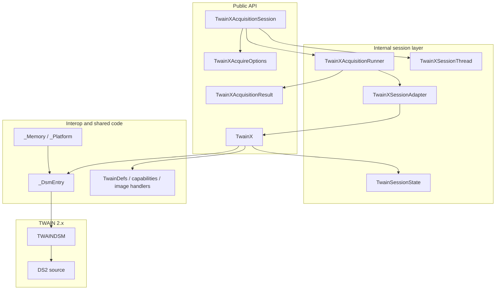
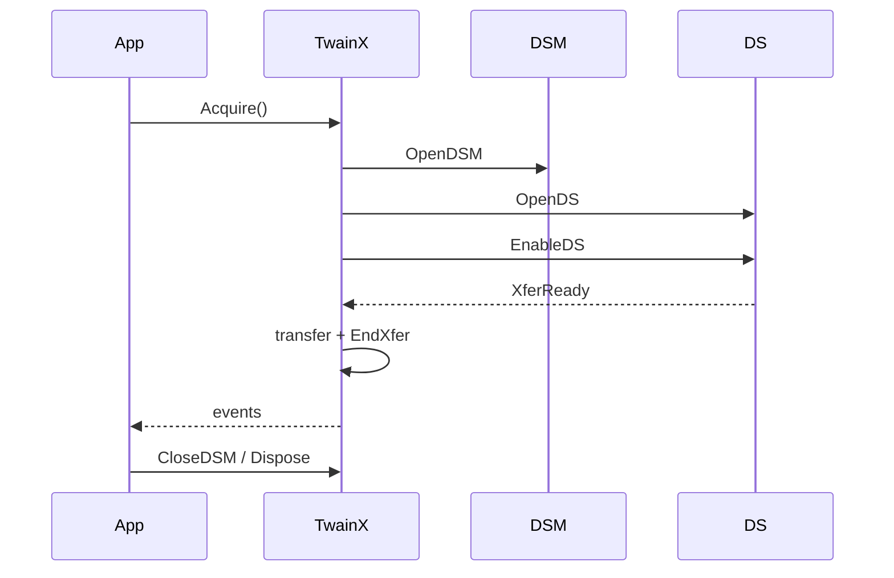
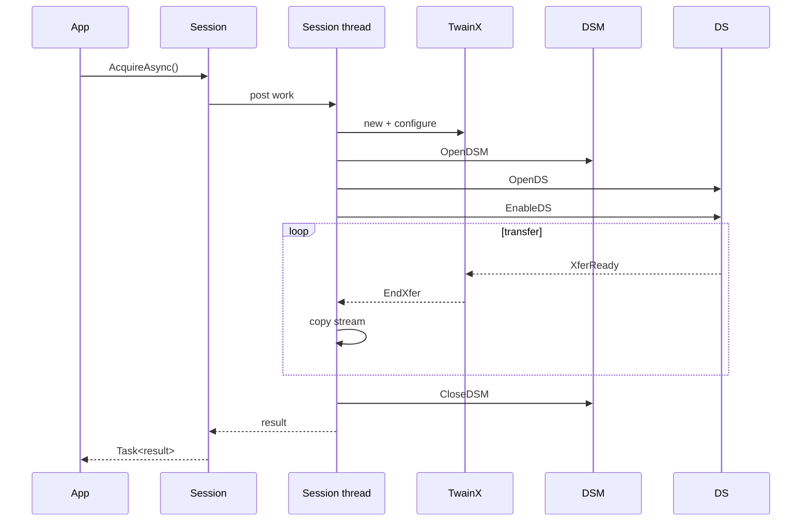
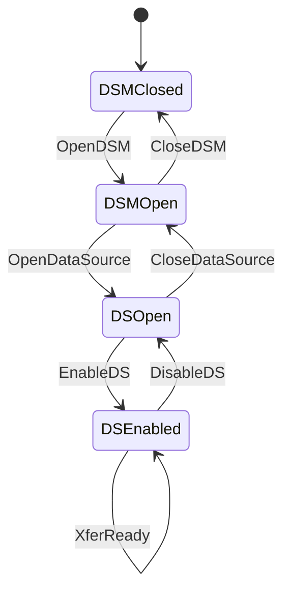
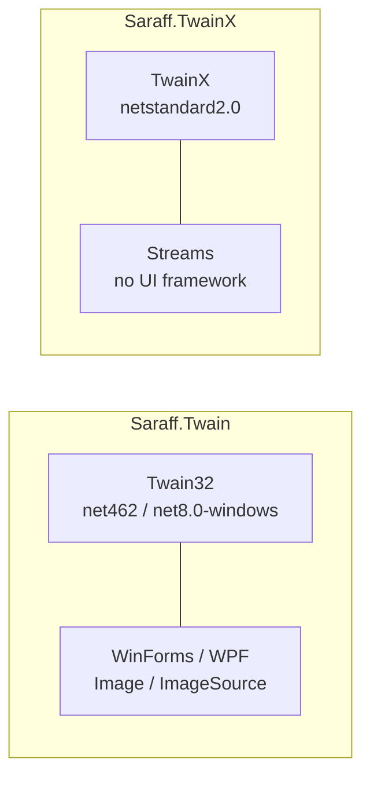

[All products](../) / [Saraff.TwainX](./index.md)
# Architecture

`Saraff.TwainX` is a managed TWAIN 2.x client. It talks to the native Data Source Manager and
converts transferred data to .NET `Stream` objects.

## Components

### Main types

| Type | Role |
|---|---|
| `TwainX` | Synchronous component and TWAIN session |
| `TwainXAcquisitionSession` | Async facade; owns a dedicated session thread |
| `TwainXAcquireOptions` | Source UI, parent, page limit and progress |
| `TwainXAcquisitionResult` | Result-owned stream copies and image metadata |
| `TwainSessionState` | Session flags: DSM/DS open, enabled, ready |
| `TwainXAcquisitionRunner` | Opens/enables/closes the session and collects streams |
| `TwainXSessionThread` | Dedicated thread, STA and Win32 pump on Windows |
| `TwainXSessionAdapter` | Internal adapter used by the async runner |

## Synchronous flow

`Acquire()` runs on the caller's thread. The caller must provide a message loop on Windows (for
example, a WinForms/WPF application thread).

## Asynchronous flow

The async path does not expose `TwainX` to the caller. This keeps all TWAIN calls on the session
thread and avoids cross-thread `Dispose` issues.

## Event flow

Events:

* `EndXfer` — a transferred image is ready as a `Stream`;
* `XferDone` — image metadata is available and a transfer can be cancelled;
* `AcquireCompleted` — a `XFerReady` cycle completed;
* `AcquireError` — a TWAIN error;
* `TwainStateChanged` — session flags changed;
* `DeviceEvent` — a source device event.

`AcquireCompleted` can fire more than once. For “scan finished”, combine it with
`TwainStateChanged`, `DisableAfterAcquire`, `MaxImages` or the async result API.

## Design constraints

* TWAIN 2.x/DS2 only; TWAIN 1.x is handled by `Saraff.Twain`.
* `netstandard2.0`; no WinForms/WPF types.
* One TWAIN session per acquisition.
* All session calls must use one thread.
* Native memory is released through `TwainDsmBuffer`/`_Memory` helpers.
* Events are invoked through a safe dispatcher that isolates handler exceptions.
* Native transfer can be customised through `IStreamProvider` and `IImageHandler`; custom image
  types are created through `IImageFactory<T>` — see [Image Pipeline](./ImagePipeline.md).

## Product boundary

The products share only source-level interop definitions and low-level helpers; their public APIs
and packages are independent.

## Next

* [Async Acquisition](./AsyncAcquisition.md)
* [Threading and UI](./Threading.md)
* [Images and Transfer](./TransferAndImages.md)
