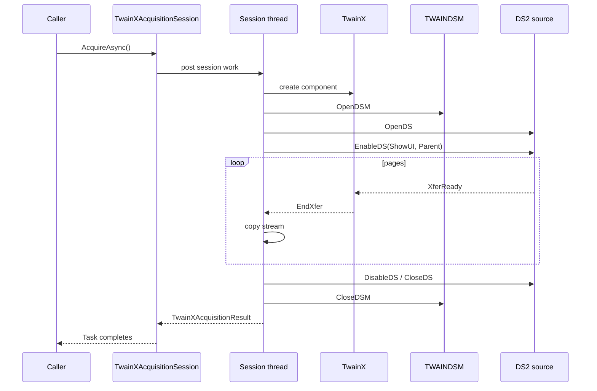
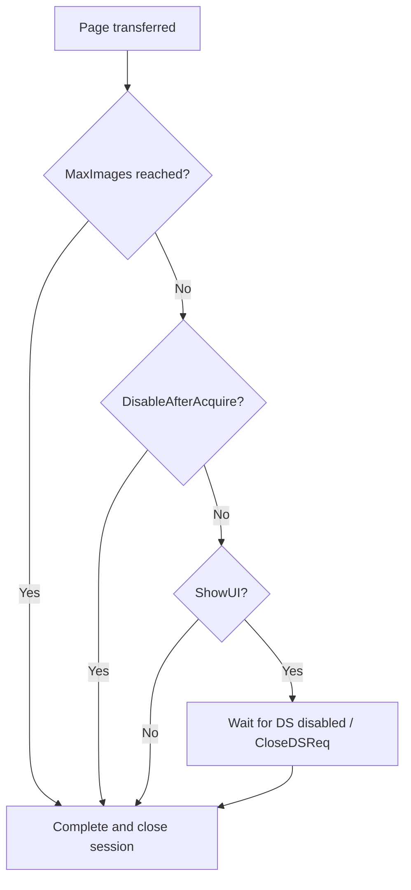
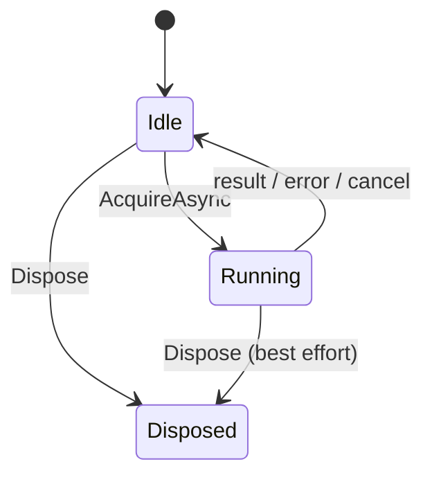

[All products](../) / [Saraff.TwainX](./index.md)
# Asynchronous Acquisition

`TwainXAcquisitionSession` runs a complete TWAIN 2.x acquisition on a dedicated session thread and
returns a task. The synchronous `TwainX.Acquire()` API remains available and unchanged.

## Why a dedicated thread

TWAIN session objects are thread-affine: the DSM and the data source must be opened, used and closed
on the same thread. The asynchronous API creates that thread for you, so the UI thread is not blocked
by `EnableDS`/`DisableDS` or the source UI.



On Windows the session thread is **STA** and runs a Win32 message pump. On Linux/macOS the thread is
a serialized background thread without a Win32 pump; support depends on the DSM/source.

## API

```csharp
public sealed class TwainXAcquisitionSession : IDisposable
{
    public TwainXAcquisitionSession();
    public TwainXAcquisitionSession(TwainXAcquireOptions options);

    public Task<TwainXAcquisitionResult> AcquireAsync(
        CancellationToken cancellationToken = default);
}
```

```csharp
public sealed class TwainXAcquireOptions
{
    public bool ShowUI { get; set; }
    public bool ModalUI { get; set; }
    public IntPtr Parent { get; set; }
    public string DsmPath { get; set; }
    public int? MaxImages { get; set; }
    public bool DisableAfterAcquire { get; set; } // default true
    public IProgress<TwainXAcquisitionProgress> Progress { get; set; }
}
```

```csharp
public sealed class TwainXAcquisitionResult : IDisposable
{
    public IReadOnlyList<Stream> Streams { get; }
    public IReadOnlyList<TwainX.ImageInfo> ImageInfos { get; }
    public void Dispose();
}
```

## Basic example

```csharp
using System;
using System.IO;
using System.Threading;
using Saraff.TwainX;

public async Task ScanAsync(IntPtr parentHandle, CancellationToken cancellationToken)
{
    var options = new TwainXAcquireOptions {
        ShowUI = true,
        ModalUI = false,
        Parent = parentHandle,
        DisableAfterAcquire = true,
        MaxImages = 1
    };

    using (var session = new TwainXAcquisitionSession(options))
    using (var result = await session.AcquireAsync(cancellationToken)) {
        for (var i = 0; i < result.Streams.Count; i++) {
            using (var file = File.Create($"scan-{i}.png")) {
                result.Streams[i].CopyTo(file);
            }
        }
    }
}
```

`Streams` contains result-owned `MemoryStream` copies. They are safe to use after the TWAIN session
has been closed.

## Multiple pages

```csharp
using (var session = new TwainXAcquisitionSession(new TwainXAcquireOptions {
    ShowUI = true,
    DisableAfterAcquire = false,
    MaxImages = 10
})) {
    using (var result = await session.AcquireAsync()) {
        Console.WriteLine($"Pages: {result.Streams.Count}");
    }
}
```

Rules:

* `MaxImages = 1` (or any explicit limit) stops after the requested number of pages.
* `DisableAfterAcquire = true` completes after the first `XFerReady` cycle.
* `ShowUI = true` and `DisableAfterAcquire = false` waits until the user closes the source UI and the
  DS becomes disabled, or until `MaxImages` is reached.
* `ShowUI = false` and `DisableAfterAcquire = false` completes after the first page to avoid a
  session that can never be closed.



`AcquireCompleted` is raised per `XFerReady`, not only once for the whole job. The session tracks the
final state separately.

## Progress

```csharp
var options = new TwainXAcquireOptions {
    Progress = new Progress<TwainXAcquisitionProgress>(p => {
        Console.WriteLine($"Page {p.PageNumber}: {p.ImageInfo?.ImageWidth}x{p.ImageInfo?.ImageLength}");
    })
};
```

In the current implementation progress is reported on the session thread. Marshal to the UI thread
yourself if the callback updates UI.

## Cancellation

```csharp
using (var cts = new CancellationTokenSource(TimeSpan.FromSeconds(30))) {
    using (var session = new TwainXAcquisitionSession(options)) {
        try {
            using (var result = await session.AcquireAsync(cts.Token)) {
                // ...
            }
        } catch (OperationCanceledException) {
            // The session was closed or the wait was cancelled.
        }
    }
}
```

Cancellation is **best effort**. TWAIN has no universal cancel operation:

* the runner requests `DisableDS`/`CloseDSM` on the session thread;
* a source with a modal UI may ignore the request until the UI is closed;
* the token is checked between events and while the runner is pumping messages.

## Session lifetime



* One acquisition can run at a time on a session. A second concurrent call throws
  `InvalidOperationException`.
* The session can be reused sequentially after a completed acquisition.
* `Dispose()` stops the session thread.
* The internal `TwainX` instance is created and disposed on the session thread; it is not exposed.

## Events versus results

| Approach | Events | Result |
|---|---|---|
| `TwainX.Acquire()` | `EndXfer`, `AcquireCompleted`, ... | None; use `EndXferEventArgs.Stream` |
| `TwainXAcquisitionSession.AcquireAsync()` | Not exposed publicly | `TwainXAcquisitionResult` |

The async API intentionally returns a result instead of forwarding the raw component events. This
keeps ownership of streams and session cleanup in one place.

## Platform matrix

| Platform | Session thread | Message pump | Notes |
|---|---|---|---|
| Windows | STA | Win32 | Recommended for source UI and TWAIN 2.x |
| Linux | Serialized background thread | No Win32 pump | Depends on DSM; test with the target source |
| macOS | Serialized background thread | No Win32 pump | Best effort; not all DSM builds support it |

## Limitations

* TWAIN 2.x/DS2 source and DSM are required.
* `Saraff.TwainX` does not provide WinForms/WPF images; the result contains streams.
* A source with a modal UI can delay cancellation.
* Only one acquisition per session at a time.
* The result streams must be disposed by the caller.

## Next

* [Threading and UI](./Threading.md)
* [Images and Transfer](./TransferAndImages.md)
* [Troubleshooting](./Troubleshooting.md)
