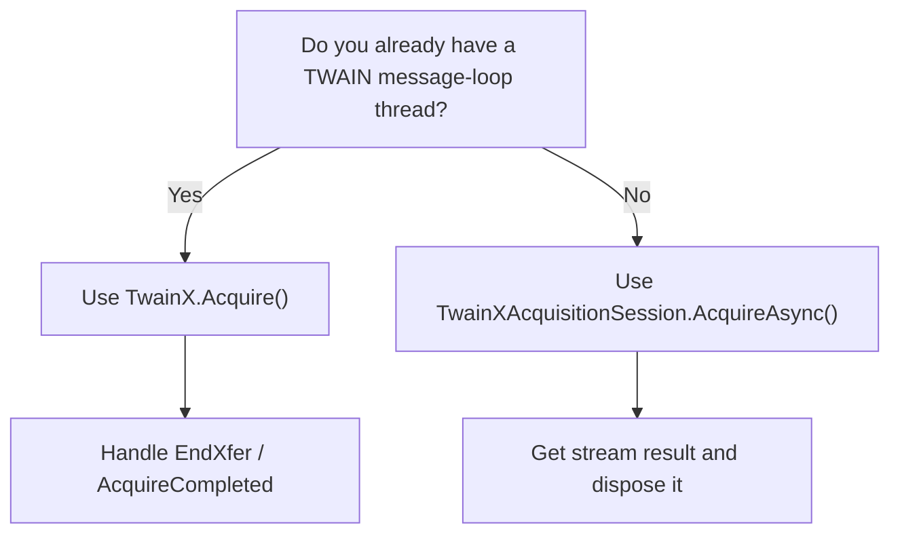
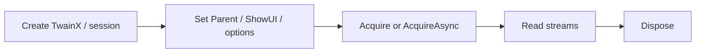

[All products](../) / [Saraff.TwainX](./index.md)
# Getting Started

## 1. Install

```powershell
dotnet add package Saraff.TwainX
```

```xml
<ItemGroup>
  <PackageReference Include="Saraff.TwainX" Version="1.0.33.756" />
</ItemGroup>
```

`Saraff.TwainX` targets `netstandard2.0`. It can be used from .NET Framework 4.6.1+, .NET Core/.NET
5+ and Mono (a native TWAIN DSM must be available for the target platform). It has no WinForms or WPF
dependency.

> The package id is `Saraff.TwainX`. Older documentation may mention `Saraff.TwainX.NET`; see
> [Migration](./Migration.md).

## 2. Choose synchronous or asynchronous



* Use `Acquire()` when your application already has a UI/main message loop and wants event-driven
  scanning.
* Use `AcquireAsync()` when the caller should not own the TWAIN thread.

## 3. Synchronous scan

```csharp
using System;
using System.IO;
using Saraff.TwainX;

public void Scan(IntPtr parentHandle)
{
    using (var twain = new TwainX()) {
        twain.ShowUI = true;
        twain.DisableAfterAcquire = true;
        twain.Parent = parentHandle;

        twain.EndXfer += (sender, e) => {
            using (var stream = e.Stream) {
                using (var file = File.Create($"scan-{Guid.NewGuid():N}.tiff")) {
                    stream.CopyTo(file);
                }
            }
        };

        twain.AcquireError += (sender, e) => {
            Console.WriteLine(e.Exception.Message);
        };

        twain.Acquire();
    }
}
```

`Acquire()` opens the DSM and the source, enables it and starts the TWAIN event flow. It requires a
TWAIN 2.x/DS2 source.

## 4. Asynchronous scan

```csharp
using System;
using System.IO;
using System.Threading.Tasks;
using Saraff.TwainX;

public async Task ScanAsync(IntPtr parentHandle)
{
    var options = new TwainXAcquireOptions {
        ShowUI = true,
        DisableAfterAcquire = true,
        MaxImages = 1,
        Parent = parentHandle
    };

    using (var session = new TwainXAcquisitionSession(options))
    using (var result = await session.AcquireAsync()) {
        for (var i = 0; i < result.Streams.Count; i++) {
            using (var file = File.Create($"scan-{i}.tiff")) {
                result.Streams[i].CopyTo(file);
            }
        }
    }
}
```

On Windows the session uses a dedicated STA thread with a Win32 message pump. See
[Async Acquisition](./AsyncAcquisition.md) for completion rules and cancellation.

## 5. Select a source

```csharp
using (var twain = new TwainX()) {
    twain.SelectSource();
    twain.Acquire();
}
```

`SelectSource()` shows the standard TWAIN source selection dialog. `SourcesCount`,
`GetSourceProductName(index)` and `GetSourceIdentity(index)` enumerate known sources.

## 6. Configure capabilities

```csharp
twain.Capabilities.XResolution.Set(300f);
twain.Capabilities.YResolution.Set(300f);
twain.Capabilities.PixelType.Set(TwPixelType.RGB);
twain.Capabilities.FeederEnabled.Set(true);
twain.Capabilities.DuplexEnabled.Set(false);
twain.Capabilities.XferMech.Set(TwSX.Native);
```

Always check support before setting a value:

```csharp
if ((twain.Capabilities.FeederEnabled.IsSupported() & TwQC.Set) != 0) {
    twain.Capabilities.FeederEnabled.Set(true);
}
```

## 7. Stream ownership

`EndXferEventArgs.Stream` is owned by the event args and is rewound to the beginning. If you keep it
after the handler returns, copy it:

```csharp
twain.EndXfer += (sender, e) => {
    var copy = new MemoryStream();
    e.Stream.CopyTo(copy);
    copy.Position = 0;
    this.images.Add(copy);
};
```

`TwainXAcquisitionResult.Streams` already contains result-owned copies.

## 8. Lifecycle



* Do not use one `TwainX` instance from multiple threads.
* Call `Acquire()` on the thread that owns the TWAIN message loop.
* Use `AcquireAsync()` if you do not have such a thread.
* Dispose the component/session when the scan is finished.

## Next

* [Async Acquisition](./AsyncAcquisition.md)
* [Threading and UI](./Threading.md)
* [Images and Transfer](./TransferAndImages.md)
