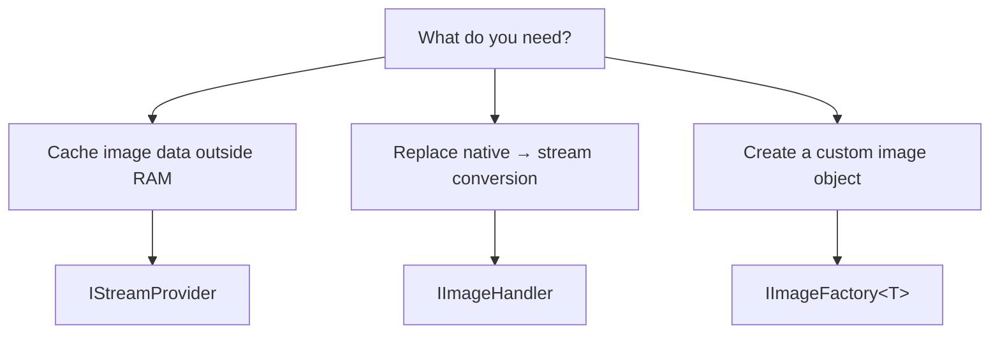

[All products](../) / [Saraff.TwainX](./index.md)
# Image Pipeline

`Saraff.TwainX` is stream-first, but it keeps the same three extension points as the Windows
product:

| Interface | Role | Used by |
|---|---|---|
| `IStreamProvider` | Supplies a stream for native image data | `IImageHandler` / native transfer |
| `IImageHandler` | Converts native memory to a stream | native transfer |
| `IImageFactory<T>` | Converts a stream to a custom image type | `EndXferEventArgs.CreateImage<T>()` |


There is no built-in `Bitmap`/`ImageSource` type in `Saraff.TwainX`; the application chooses its own
image type through `IImageFactory<T>`.

## `IStreamProvider`

```csharp
using System.IO;
using Saraff.TwainX;

internal sealed class TempFileStreamProvider : IStreamProvider {
    public Stream GetStream() {
        return new FileStream(
            Path.GetTempFileName(),
            FileMode.Create,
            FileAccess.ReadWrite,
            FileShare.Read,
            64 * 1024,
            FileOptions.DeleteOnClose);
    }
}
```

## `IImageHandler`

```csharp
using System;
using System.IO;
using Saraff.TwainX;

internal sealed class MyDibHandler : IImageHandler {
    public Stream PtrToStream(IntPtr ptr, IStreamProvider provider) {
        Stream stream = provider != null ? provider.GetStream() : new MemoryStream();

        // Read the native header and pixel data from ptr,
        // write a supported image format to stream,
        // then rewind it.
        stream.Position = 0;
        return stream;
    }
}
```

During native transfer the component resolves `IImageHandler` and `IStreamProvider` through
`GetService`, converts the native block to a stream and raises `EndXfer`.

## `IImageFactory<T>`

```csharp
using System.IO;
using Saraff.TwainX;

public sealed class MyImage {
    public byte[] Data { get; set; }
}

public sealed class MyImageFactory : IImageFactory<MyImage> {
    public MyImage Create(Stream stream) {
        using (var copy = new MemoryStream()) {
            stream.CopyTo(copy);
            return new MyImage { Data = copy.ToArray() };
        }
    }
}
```

```csharp
twain.EndXfer += (sender, e) => {
    var image = e.CreateImage(new MyImageFactory());
    this.images.Add(image);
};
```

## Registration

Register `IStreamProvider`/`IImageHandler` in the site/container that creates the component:

```csharp
using Saraff.IoC;

var container = new ServiceContainer();
container.Bind<IStreamProvider, TempFileStreamProvider>();
container.Bind<IImageHandler, MyDibHandler>();

var twain = container.CreateInstance<TwainX>();
```

`IImageFactory<T>` is passed explicitly to `CreateImage<T>()`, so it can be a simple object or a
service resolved by your own code.

## Choosing an extension point



## Async acquisition

The async API already copies transferred streams into result-owned `MemoryStream` objects. Use a
custom `IImageHandler`/`IStreamProvider` when you need a different native conversion or caching
strategy; use `IImageFactory<T>` in the synchronous event pipeline when you need a custom image
type.

## Related

* [Images and Transfer](./TransferAndImages.md)
* [Architecture](./Architecture.md)
* [Getting Started](./GettingStarted.md)
