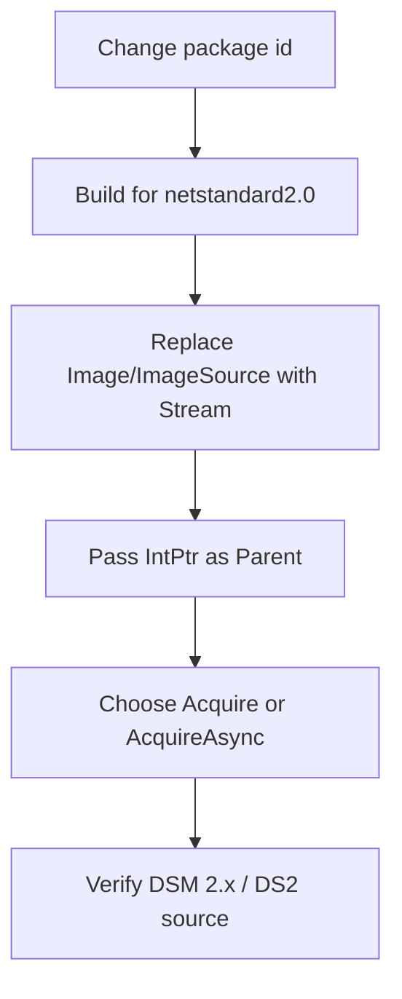

[All products](../) / [Saraff.TwainX](./index.md)
# Migration

## From `Saraff.TwainX.NET`

The product was previously published as `Saraff.TwainX.NET` and documented with Xamarin-era target
frameworks. The current package is `Saraff.TwainX`.

| | Old | Current |
|---|---|---|
| Package | `Saraff.TwainX.NET` | `Saraff.TwainX` |
| Namespace | `Saraff.TwainX` | `Saraff.TwainX` |
| Main class | `TwainX` | `TwainX` |
| Target | .NET Standard 2.0 | `netstandard2.0` |
| TWAIN | 2.x | 2.x / DS2 only |
| Images | stream | stream |
| Parent | `IntPtr` | `IntPtr` |
| Sync API | `Acquire()` | `Acquire()` (unchanged) |
| Async API | — | `TwainXAcquisitionSession.AcquireAsync()` |

## Package id

Replace:

```xml
<PackageReference Include="Saraff.TwainX.NET" Version="..." />
```

with:

```xml
<PackageReference Include="Saraff.TwainX" Version="1.0.33.756" />
```

The namespace/type names stay the same, so most C# code compiles unchanged. Verify package-level
references, `using` directives and any assembly-name-specific configuration.

## Image API

The old API exposed streams through `EndXfer`. The current API keeps that and adds a direct stream
property:

```csharp
twain.EndXfer += (sender, e) => {
    using (var stream = e.Stream) {
        stream.CopyTo(target);
    }
};
```

For custom image types use `CreateImage<T>(IImageFactory<T>)`.

## Parent and UI

`Saraff.TwainX` does not reference WinForms or WPF. `Parent` is an `IntPtr`:

```csharp
twain.Parent = windowHandle;
```

If you migrate from `Saraff.Twain` (`Twain32`), replace `IWin32Window` with the window handle and
replace `Image`/`ImageSource` with your own stream-to-image conversion.

## Synchronous to asynchronous

The synchronous API is still available:

```csharp
using (var twain = new TwainX()) {
    twain.EndXfer += (sender, e) => { /* stream */ };
    twain.Acquire();
}
```

The new asynchronous API is additive:

```csharp
using (var session = new TwainXAcquisitionSession(options))
using (var result = await session.AcquireAsync()) {
    // result.Streams
}
```

Do not call both APIs on the same `TwainX` instance at the same time.

## Behaviour differences

| Area | Notes |
|---|---|
| `ShowUI` | Defaults to `false` in `TwainX` (unlike `Twain32`) |
| `DisableAfterAcquire` | Defaults to `true` |
| `AcquireCompleted` | Fires per `XFerReady`, not once per job |
| `Parent` | IntPtr; applied to `EnableDS` only |
| Threading | Session operations must use one thread |
| Async | Windows STA + Win32 pump; other platforms best effort |

## Migration checklist



## Next

* [Getting Started](./GettingStarted.md)
* [Async Acquisition](./AsyncAcquisition.md)
* [Troubleshooting](./Troubleshooting.md)
