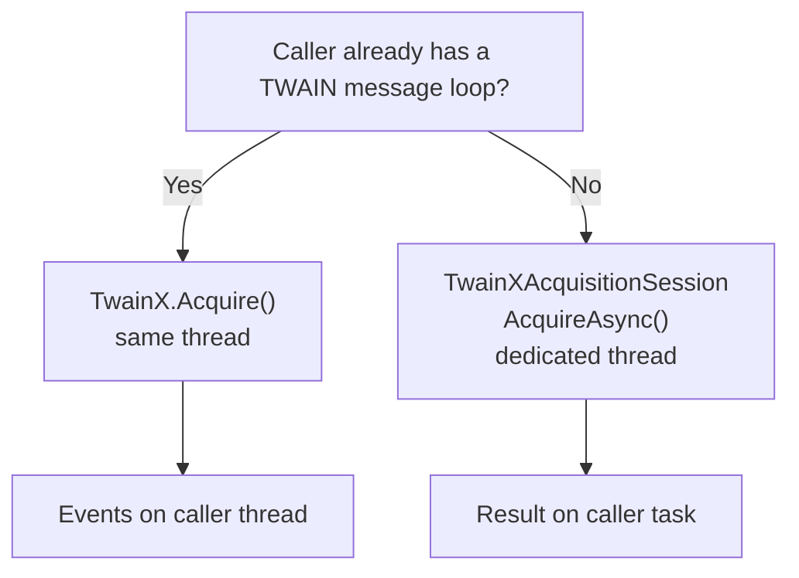
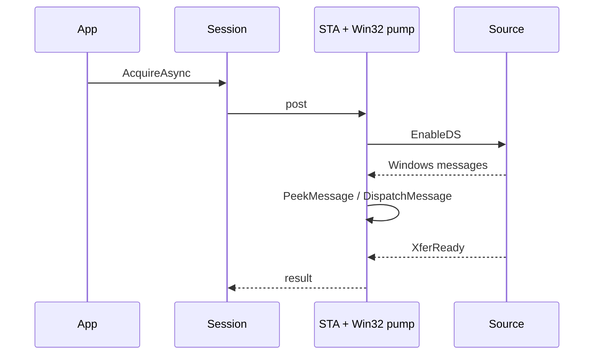

[All products](../) / [Saraff.TwainX](./index.md)
# Threading and UI

TWAIN is a single-threaded API. `Saraff.TwainX` enforces this rule: a `TwainX` instance is bound to
the first thread that performs a TWAIN operation.

## Two supported models



### Synchronous `Acquire()`

Use it when:

* the application has a WinForms/WPF UI thread;
* the caller can keep a message loop running;
* you want event-driven page handling.

```csharp
using (var twain = new TwainX()) {
    twain.Parent = parentHandle;
    twain.EndXfer += (sender, e) => { /* page */ };
    twain.Acquire();
}
```

Call `Acquire()` on the UI/main thread. Do not call it from `Task.Run`, a thread-pool thread or a
timer callback unless that thread has a message loop and remains alive for the whole session.

### Asynchronous `AcquireAsync()`

Use it when:

* the caller should stay responsive;
* you do not have a TWAIN message-loop thread;
* you prefer a `Task<TwainXAcquisitionResult>` over events.

```csharp
using (var session = new TwainXAcquisitionSession(options))
using (var result = await session.AcquireAsync(token)) {
    // streams
}
```

The session thread is created, used and disposed by `TwainXAcquisitionSession`.

## Windows: STA and message pump

On Windows the async session thread is:

* **STA**;
* backed by a Win32 message pump;
* owned by `TwainXSessionThread`.



This is required for sources that create windows or rely on `WM_` messages.

## Linux and macOS

There is no Win32 message pump and no STA. The async session still uses one dedicated thread, but
the source UI behavior depends on the DSM and the source. Test async acquisition against the exact
DSM/source combination you ship.

## Parent window

`TwainX.Parent` is an `IntPtr`, not a WinForms `IWin32Window`.

```csharp
twain.Parent = this.Handle;          // WinForms
twain.Parent = new WindowInteropHelper(window).Handle; // WPF
```

`Parent` is applied to `DG_CONTROL / DAT_USERINTERFACE / MSG_ENABLEDS`. It is not used for
`OpenDSM`/`CloseDSM`/`DisableDS` in this product.

For `AcquireAsync`, pass the handle through `TwainXAcquireOptions.Parent`.

## Event threads

* `TwainX.Acquire()` raises events on the TWAIN thread.
* `TwainXAcquisitionSession` returns a task and does not expose the raw events.
* `TwainXAcquireOptions.Progress` is currently invoked on the session thread; marshal UI updates
  yourself.

```csharp
var options = new TwainXAcquireOptions {
    Progress = new Progress<TwainXAcquisitionProgress>(p => {
        // Progress<T> captures the current SynchronizationContext.
        this.StatusLabel.Text = $"Page {p.PageNumber}";
    })
};
```

## Deadlocks

Avoid:

```csharp
// Can deadlock if continuations need the UI thread.
var result = session.AcquireAsync().Result;
```

Prefer:

```csharp
using (var result = await session.AcquireAsync()) {
    // ...
}
```

If you must block, use a dedicated non-UI thread and make sure progress/event callbacks do not
marshal back to the blocked UI thread.

## One session at a time

* A `TwainXAcquisitionSession` rejects a second concurrent `AcquireAsync()` with
  `InvalidOperationException`.
* Do not run two TWAIN sessions against the same source/DSM at the same time.
* The session can be reused sequentially after the previous task completes.

## Disposal

```csharp
using (var session = new TwainXAcquisitionSession(options)) {
    using (var result = await session.AcquireAsync()) {
        // result owns its streams
    }
}
```

The session disposes its internal `TwainX` on the session thread. Do not dispose the component from
another thread while acquisition is running.

## Next

* [Async Acquisition](./AsyncAcquisition.md)
* [Images and Transfer](./TransferAndImages.md)
* [Troubleshooting](./Troubleshooting.md)
