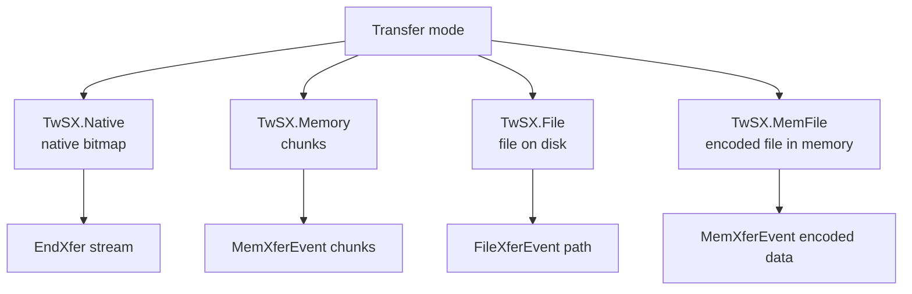

[All products](../) / [Saraff.TwainX](./index.md)
# Images and Transfer

`Saraff.TwainX` is stream-based. It does not depend on `System.Drawing.Common`, WinForms or WPF.

## EndXfer

```csharp
twain.EndXfer += (sender, e) => {
    if (e.Cancel) {
        return;
    }

    using (var stream = e.Stream) {
        // The stream is positioned at the beginning.
        using (var file = File.Create("scan.tiff")) {
            stream.CopyTo(file);
        }
    }
};
```

`EndXferEventArgs` provides:

| Member | Description |
|---|---|
| `Stream` | Underlying image stream, rewound to the beginning |
| `CreateImage<T>(IImageFactory<T>)` | Convert the stream to a custom image type |
| `Cancel` | Request cancellation of the current transfer |

The stream is owned by the event args. If you need it after the handler returns, copy it to a
`MemoryStream`.

## Stream to image

`Saraff.TwainX` deliberately has no built-in `Bitmap` type. Use your own factory:

```csharp
public sealed class BitmapFactory : IImageFactory<Bitmap> {
    public Bitmap Create(Stream stream) {
        // Bitmap is available only if the application references System.Drawing.Common.
        return new Bitmap(stream);
    }
}

twain.EndXfer += (sender, e) => {
    var bitmap = e.CreateImage(new BitmapFactory());
    // ...
};
```

This keeps the library usable on platforms where GDI+ is unavailable.

## Transfer modes



### Native

```csharp
twain.Capabilities.XferMech.Set(TwSX.Native);
```

The source returns a native bitmap; `Saraff.TwainX` converts it through the default platform handler
and raises `EndXfer`.

### Buffered memory

```csharp
twain.Capabilities.XferMech.Set(TwSX.Memory);
twain.SetupMemXferEvent += (sender, e) => {
    // e.ImageInfo / e.BufferSize
};
twain.MemXferEvent += (sender, e) => {
    // e.ImageMemXfer.ImageData / e.ImageMemXfer.BytesPerRow
};
```

### Disk file

```csharp
twain.Capabilities.XferMech.Set(TwSX.File);
twain.SetupFileXferEvent += (sender, e) => {
    e.FileName = Path.Combine(Path.GetTempPath(), "scan.bmp");
};
twain.FileXferEvent += (sender, e) => {
    // e.ImageFileXfer.FileName
};
```

### Memory file

```csharp
twain.Capabilities.XferMech.Set(TwSX.MemFile);
twain.Capabilities.ImageFileFormat.Set(TwFF.Jpeg);
```

## Image metadata

```csharp
twain.XferDone += (sender, e) => {
    var info = e.GetImageInfo();
    Console.WriteLine($"{info.ImageWidth} x {info.ImageLength}, {info.XResolution} dpi");
};
```

`XferDone` fires before `EndXfer`, so it is a good place to capture metadata for the next image.

## Async result

```csharp
using (var result = await session.AcquireAsync()) {
    for (var i = 0; i < result.Streams.Count; i++) {
        var info = result.ImageInfos[i];
        Console.WriteLine($"{info?.ImageWidth} x {info?.ImageLength}");
        using (var file = File.Create($"scan-{i}.tiff")) {
            result.Streams[i].CopyTo(file);
        }
    }
}
```

`TwainXAcquisitionResult.Streams` contains `MemoryStream` copies. The result owns them and disposes
them when you dispose the result.

## Progress

```csharp
var options = new TwainXAcquireOptions {
    Progress = new Progress<TwainXAcquisitionProgress>(p => {
        Console.WriteLine($"Page {p.PageNumber}");
    })
};
```

The current implementation reports progress on the session thread. Use `Progress<T>` or marshal
manually if the handler touches UI.

## Disposal

* Dispose the `TwainXAcquisitionResult` after saving/copying streams.
* Dispose `TwainX`/`TwainXAcquisitionSession` when the session is finished.
* Do not dispose a stream while another consumer is still reading it.

## Next

* [Async Acquisition](./AsyncAcquisition.md)
* [Threading and UI](./Threading.md)
* [Troubleshooting](./Troubleshooting.md)
