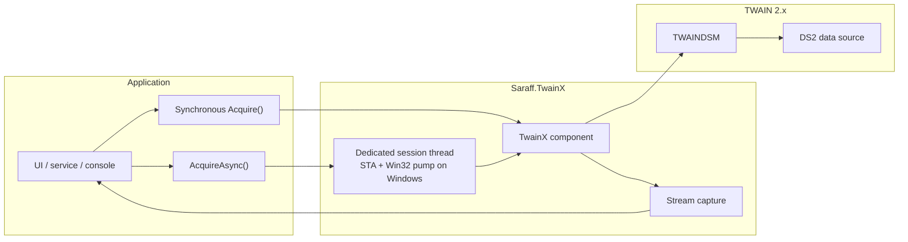

[All products](../)
# Saraff.TwainX

**Saraff.TwainX** is a fully managed, stream-based TWAIN 2.x component for .NET Standard. It is the
cross-platform counterpart of [Saraff.Twain.NET](../sarafftwain/index.md).

| | |
|---|---|
| **Package** | [`Saraff.TwainX`](https://www.nuget.org/packages/Saraff.TwainX/) |
| **Main class** | `Saraff.TwainX.TwainX` |
| **Target framework** | `netstandard2.0` |
| **TWAIN** | 2.x / DS2 data sources only |
| **Images** | `Stream` (no `System.Drawing.Image` dependency) |
| **UI** | No WinForms/WPF dependency; `Parent` is `IntPtr` |
| **Async** | `TwainXAcquisitionSession.AcquireAsync()` |
| **License** | LGPL-3.0-or-later |

> **Important:** `Saraff.TwainX` and `Saraff.Twain` are different products. They have different
> package ids, assembly names, namespaces and image models. Do not mix their types.

## The model in one picture



`TwainX` opens the DSM and the source, enables the source and raises events when image data arrives.
The synchronous API uses the caller's thread; the asynchronous API creates a dedicated session
thread and returns a result object.

## Quick start: synchronous

```csharp
using Saraff.TwainX;

IntPtr parentHandle = GetMainWindowHandle();

using (var twain = new TwainX()) {
    twain.ShowUI = true;
    twain.DisableAfterAcquire = true;
    twain.Parent = parentHandle;

    twain.EndXfer += (sender, e) => {
        using (var stream = e.Stream) {
            // Copy or save the image before the session is closed.
            using (var file = File.Create($"scan-{Guid.NewGuid():N}.png")) {
                stream.CopyTo(file);
            }
        }
    };
    twain.AcquireError += (sender, e) => {
        Console.WriteLine(e.Exception.Message);
    };

    twain.Acquire();
}
```

`Acquire()` requires a TWAIN 2.x/DS2 source and a TWAIN 2.x DSM.

## Quick start: asynchronous

```csharp
using Saraff.TwainX;

using (var session = new TwainXAcquisitionSession(new TwainXAcquireOptions {
    ShowUI = true,
    DisableAfterAcquire = true,
    MaxImages = 1
})) {
    using (var result = await session.AcquireAsync()) {
        foreach (var stream in result.Streams) {
            using (var file = File.Create($"scan-{Guid.NewGuid():N}.png")) {
                stream.CopyTo(file);
            }
        }
    }
}
```

The result owns its streams; they are copies and remain valid after the TWAIN session is closed.
See [Async Acquisition](./AsyncAcquisition.md) for completion rules, cancellation and platform details.

Install:

```powershell
dotnet add package Saraff.TwainX
```

## Documentation map

### Start here

* [Getting Started](./GettingStarted.md) — sync and async first scan
* [Async Acquisition](./AsyncAcquisition.md) — dedicated STA thread, `MaxImages`, cancellation
* [Architecture](./Architecture.md) — components, session thread and event flow

### Everyday use

* [Threading and UI](./Threading.md) — `Acquire()` vs `AcquireAsync()`, `Parent`, event threads
* [Images and Transfer](./TransferAndImages.md) — streams, ownership, transfer modes, progress
* [Image Pipeline](./ImagePipeline.md) — `IStreamProvider`, `IImageHandler`, `IImageFactory<T>`
* [API Reference](./ApiReference.md) — public types at a glance

### Migration and support

* [Migration from Saraff.TwainX.NET](./Migration.md)
* [Troubleshooting](./Troubleshooting.md)

## Features

* TWAIN 2.x / DS2 only
* `netstandard2.0`; usable from .NET Framework 4.6.1+, .NET Core/.NET 5+ and Mono (a native TWAIN DSM is required for the target platform)
* No WinForms, WPF or `System.Drawing.Common` dependency
* Native, Buffered Memory, Disk File and Memory File transfer modes
* Stream-based image access with explicit ownership
* Source enumeration and selection
* ADF and duplex control through TWAIN capabilities
* Extended image information
* Synchronous `Acquire()` and asynchronous `AcquireAsync()`
* Dedicated STA thread with a Win32 message pump on Windows for async acquisition

## Supported platforms

| Platform | Synchronous `Acquire()` | Asynchronous `AcquireAsync()` |
|---|---|---|
| Windows | Yes, on an application message-loop thread | Yes, dedicated STA thread + Win32 pump |
| Linux | Yes, depending on DSM | Dedicated thread without Win32 pump; best effort |
| macOS | Yes, depending on DSM | Dedicated thread without Win32 pump; best effort |

`Saraff.TwainX` requires a TWAIN 2.x DSM and a DS2 source. TWAIN 1.x sources are supported only by
the Windows `Saraff.Twain` product.

## Samples

The original sample archives target older package names; the API shape is still useful:

* [Saraff.TwainX.NET Core Sample1]()
* [Saraff.TwainX.NET Core Sample2]()
* [Saraff.TwainX.NET Core Sample3]()
* [Saraff.TwainX.NET WinForms Sample1]()
* [Saraff.TwainX.NET WinForms Sample2]()
* [Saraff.TwainX.NET WPF Sample1]()


**Figure 1 - Saraff.TwainX Core Sample2 on Windows 10**


**Figure 2 - Saraff.TwainX WinForms Sample2 on Windows 10**


**Figure 3 - Saraff.TwainX WPF Sample1 on Windows 10**

_If you notice an error, please let me know about it._
